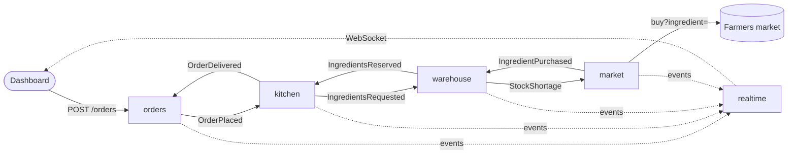

# Free Lunch Day

A restaurant gives away free lunches for a whole day. The manager presses one button to order
any number of dishes, and the rest happens on its own: the kitchen picks a random recipe for
each dish, asks the warehouse for the ingredients, the warehouse buys whatever is missing at
the farmers market, and the dish is delivered once every ingredient is there. A dashboard shows
it all in real time.

**Live dashboard:** https://d2dy6tdbg4ssp2.cloudfront.net

Built for the Alegra backend challenge: Node.js and TypeScript microservices without Express,
Nest or similar frameworks, each with its own Dockerfile, deployed serverless on AWS at no cost.
How it is built is in [docs/ARCHITECTURE.md](docs/ARCHITECTURE.md), every decision and its
reason in [docs/PLANNING.md](docs/PLANNING.md), and how it evolved, with what each test found,
in [docs/DEVLOG.md](docs/DEVLOG.md).

## How it works

Five services talk only through events (SNS topics fanned out to one SQS queue per service), and
each one owns its DynamoDB table.

| Service       | Responsibility                                                                  |
| ------------- | ------------------------------------------------------------------------------- |
| **orders**    | Manager API: places batches of dishes, starts workdays, keeps the order history |
| **kitchen**   | Picks a random recipe per dish, asks for its ingredients and delivers the dish  |
| **warehouse** | Reserves ingredients atomically, keeps the waiting list and asks for purchases  |
| **market**    | Buys at the farmers market, retrying with backoff while it has nothing to sell  |
| **realtime**  | Pushes every change to the dashboards over WebSocket                            |
| **web**       | React dashboard: orders, inventory, purchases, order history and recipes        |



What keeps it correct under thousands of simultaneous orders:

- **The database is the arbiter.** A reservation checks and deducts every ingredient of a dish
  in one DynamoDB transaction, so two dishes can never take the same unit.
- **Every consumer is idempotent.** A repeated message never deducts, buys or delivers twice.
- **One purchase per ingredient at a time.** Shortages go through a FIFO queue grouped by
  ingredient, and the demand of every waiting dish is bought together, so the market is never
  asked twice for the same need.
- **Failures retry, invalid messages do not.** Errors go back to the queue with exponential
  backoff; a message that breaks the contract goes to a dead-letter queue.

The business rules of each service are written once and run unchanged in two places:

- **On your machine**, each service is a container that is always on: it answers HTTP requests
  with `node:http` and keeps asking its SQS queue for new messages.
- **In AWS**, nothing is always on: a Lambda function starts only when a request or a message
  arrives, and stops when it is done.

Only the thin layer that receives requests and messages (`entrypoints/`) differs, so a fix in
the rules works in both places at once.

## Run it locally

Requirements: Docker. Each image installs its own dependencies.

```bash
docker compose up --build
```

Open http://localhost:8080. LocalStack emulates DynamoDB, SNS and SQS, so no AWS account is
needed; the purchases go to the real farmers market.

## Tests

Requirements: Node.js 24. Install the exact dependency versions of `package-lock.json` once:

```bash
npm ci
npm test                  # unit tests (domain and use cases, 90% coverage minimum)
npm run test:integration  # adapters against LocalStack: needs `docker compose up`
npm run e2e               # orders 5 dishes and waits until all are delivered
npm run load              # Artillery: 20 batches of 10 dishes in 10 seconds
```

`npm run e2e` and `npm run load` also run against AWS:

```bash
ORDERS_URL=<api-url> WAREHOUSE_URL=<api-url> DISHES=3 npm run e2e
npm run load -- --target <api-url>
```

The CI (GitHub Actions) checks format, lint, types, unit tests and the build, then starts the
containers and runs the integration tests and the end-to-end check.

## Deploy to AWS

Requirements: the AWS CLI logged in, and the Serverless Framework v4 logged in
(`serverless login`).

```bash
BUDGET_EMAIL=you@example.com npm run deploy:aws
```

It deploys the shared stack ([infra/aws](infra/aws/serverless.yml): topics, HTTP API and
budget alert), then each service and the dashboard, and prints the dashboard URL. The region
is `us-east-2`. On PowerShell, set the variable first with `$env:BUDGET_EMAIL = "..."`.

### Keeping it free

The deployment runs on the AWS free plan and is designed so that it cannot cost money:

- No VPC or NAT gateway; DynamoDB on demand; logs kept 7 days; no X-Ray.
- Each Lambda can run at most 10 copies at the same time (20 for the warehouse queue, which
  every dish goes through), and the HTTP API rejects requests above 50 per second, so an abuse
  cannot burn the credits.
- An AWS Budgets alert emails when the month is projected above US$10, counting usage before
  credits.
- CloudFront, Lambda, SQS and SNS stay within their always-free tiers at this scale.

## Results in AWS

| Check                    | Result                                                        |
| ------------------------ | ------------------------------------------------------------- |
| End-to-end, 3 dishes     | delivered in 7 s                                              |
| Load, 200 dishes at once | 20/20 batches accepted, p95 400 ms; all delivered in 1 m 48 s |
| Dead-letter queues       | empty                                                         |
| Leftover stock           | 0-2 units per ingredient: nothing bought twice                |
| Events to the dashboard  | about 0.2 s after they happen                                 |

The load test ran while the account still allowed 10 concurrent Lambdas. Most of the time was
spent waiting for the farmers market, which sells one batch per ingredient at a time.

## Repository

```
apps/web/            React + Vite dashboard (S3 + CloudFront in AWS)
packages/contracts/  events and DTOs shared by every service, validated with zod
packages/shared/     HTTP router, SNS publisher, SQS consumer, Lambda adapters, logger
services/*/          one microservice each: domain, application, infrastructure, entrypoints
infra/localstack/    tables, topics and queues for docker compose
infra/aws/           shared AWS stack
scripts/             AWS deploy and end-to-end check
load/                Artillery load test
docs/ARCHITECTURE.md how it is built and why it stays correct under load
docs/PLANNING.md     goal, decisions, alternatives and plan
docs/DEVLOG.md       how it evolved: each finding, its cause and its fix
```
