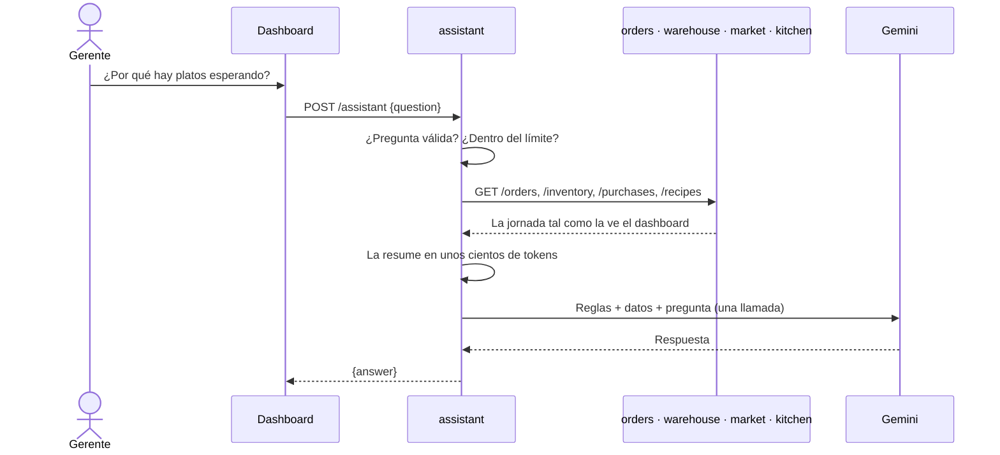

# Asistente operativo (IA)

> **English version:** [AI.md](AI.md).

El gerente que dirige la jornada de almuerzo gratis no es técnico, y durante el evento no tiene
tiempo de leer tablas. El asistente le permite preguntar en palabras sencillas y recibir una
respuesta corta con los datos en vivo de la jornada:

- "¿Por qué hay platos esperando?"
- "¿Qué compramos más en la plaza de mercado?"
- "¿Cuántos ajiacos hemos entregado?"

Vive en el panel derecho del dashboard, junto a la operación que explica.

## Cómo responde una pregunta



1. **Revisa la pregunta.** Debe tener de 1 a 500 caracteres. Una pregunta inválida se rechaza
   antes que nada, y no cuenta para el límite.
2. **Revisa el límite.** Una pregunta por encima del límite se rechaza sin leer datos ni llamar a
   Gemini, así que no cuesta nada.
3. **Lee la jornada** de la API de consulta de cada servicio dueño de los datos, las mismas APIs
   que usa el dashboard. El asistente nunca lee la tabla de otro servicio.
4. **Resume los datos** (`summarize.ts`): pedidos por estado, platos entregados por receta, los
   20 platos que más llevan esperando con qué les falta y hace cuánto, cada lote (un clic del
   botón) numerado como el historial con su hora y su duración, el lote más lento y el más
   rápido, el stock con lo que viene en camino, las compras por ingrediente y las recetas.
   Conteos en vez de cada pedido, así una pregunta cuesta la misma llamada pequeña se pidan 10 o
   10.000 platos.
5. **Le pregunta a Gemini una sola vez**, con las reglas, el resumen y la pregunta.

## Por qué una sola llamada y no *function calling*

El primer plan era *function calling*: Gemini pediría los datos herramienta por herramienta
(`getInventory`, `getPurchaseHistory`…), y el asistente ejecutaría cada una.

| | Una llamada con los datos (elegida) | *Function calling* |
| --- | --- | --- |
| Llamadas a Gemini por pregunta | 1 | 2 a 4 |
| Velocidad | ~1-4 s | varias idas y vueltas |
| Cuota gratuita | dura de 2 a 4 veces más | se gasta de 2 a 4 veces más rápido |
| Datos que caben | una jornada, resumida | cualquier cantidad |

Google no publica cifras fijas para la cuota gratuita de Gemini, así que cada llamada cuenta. Una
jornada, resumida, cabe de sobra en una llamada. *Function calling* valdría la pena con datos
demasiado grandes para enviarlos de una vez, que no es el caso.

## Las reglas que sigue el modelo

Las reglas viajan como **system instruction** de Gemini, separadas de la pregunta
(`build-prompt.ts`). Lo que escriba el gerente llega como pregunta, así que no puede
reescribirlas. El modelo debe:

- responder **solo con los datos** que llegan con la pregunta, y decirlo cuando los datos no la
  responden;
- **no inventar nunca** cifras, platos ni ingredientes;
- responder en el **idioma de la pregunta**, en máximo cuatro frases cortas o una lista corta.
  Los nombres de los platos están en español, así que las reglas lo dicen claro: una pregunta en
  inglés se responde en inglés;
- negarse a cambiar cualquier cosa: no puede hacer pedidos, y dice que eso se hace desde el
  dashboard.

Las reglas también explican cómo funciona la jornada (los estados de un plato, por qué los platos
esperan, por qué la plaza reintenta), para que el modelo pueda explicar los datos y no solo
repetirlos. La temperatura es baja (0,2), para que las respuestas se ciñan a los datos.

## Salvaguardas

| Riesgo | Salvaguarda |
| --- | --- |
| Se agota la cuota gratuita de Gemini | Máximo 10 preguntas por minuto y 200 por día, contadas en DynamoDB para que todas las Lambdas vean el mismo número. Los dos límites se pueden configurar |
| Gemini es lento, falla o se agota su cuota | Un límite de 15 s por llamada; el gerente recibe un mensaje claro ("The assistant cannot answer right now… Try again in a minute") en vez de un error |
| Alguien intenta cambiar las reglas desde la pregunta | Las reglas son la *system instruction*, separadas de la pregunta |
| La IA cambia la operación | No tiene cómo: solo lee las APIs de consulta |
| Se filtra la API key | En AWS es un SecureString en SSM Parameter Store, leído una vez por Lambda; en local está en `.env`, que Git ignora. Nunca está en el repositorio |
| No hay key (un evaluador sin una) | Todo lo demás funciona; el asistente responde que no está configurado |

## Modelo

`gemini-3.5-flash-lite`: el modelo más rápido y liviano disponible en el plan gratuito cuando se
eligió (cerca de 1 s para una respuesta corta). Está fijado en vez de usar un alias `-latest`,
para que las respuestas no cambien de comportamiento cuando Google mueva el alias. Se puede
cambiar con `GEMINI_MODEL`.

## Cómo configurarlo

**En local:** crea una key gratis, sin facturación, en https://aistudio.google.com/apikey, copia
[`.env.example`](../.env.example) a `.env` y llena `GEMINI_API_KEY`. Luego
`docker compose up --build`.

**En AWS:** guarda la key en SSM Parameter Store antes de desplegar:

```bash
aws ssm put-parameter --region us-east-2 --type SecureString \
  --name /alegra-lunch/dev/gemini-api-key --value "<tu key>"
```

## Pruebas

- **Unitarias:** el resumen, las reglas y el caso de uso, con datos, modelo y contador falsos.
- **De integración:** el adaptador de Gemini contra una copia local falsa de su API, así las
  pruebas no gastan cuota y pueden simular cualquier falla (cuota agotada, errores, respuestas
  lentas); el adaptador de datos contra servicios falsos; el contador contra DynamoDB en
  LocalStack, incluidas 20 preguntas a la vez con un límite de 5.
- **A mano:** ante "¿Qué ingrediente compramos más y cuántos platos se han entregado?", respondió
  "la papa, con 153 unidades en 14 compras… 100 platos", y los datos decían exactamente eso:
  papa, 153 unidades en 14 compras, 100 platos entregados.
- **A mano, otra vez:** ante "cuanto tardo la orden que tardo más en completar?", respondió "el
  batch 1 (100 platos)… 173 segundos, colocado a las 19:32:54": el mismo lote, la misma hora y la
  misma duración que el historial.

## Límites, con honestidad

- Responde solo sobre la **jornada actual**; comparar jornadas necesitaría una lista de jornadas
  pasadas que orders todavía no ofrece.
- En el plan gratuito, Google puede usar lo que se le envía para mejorar sus productos. Solo
  viajan datos de la operación (platos, ingredientes, compras), nada personal.
- Una respuesta es tan buena como el modelo: las reglas y la temperatura baja la ciñen a los
  datos, pero es un resumen para un gerente, no una auditoría.
