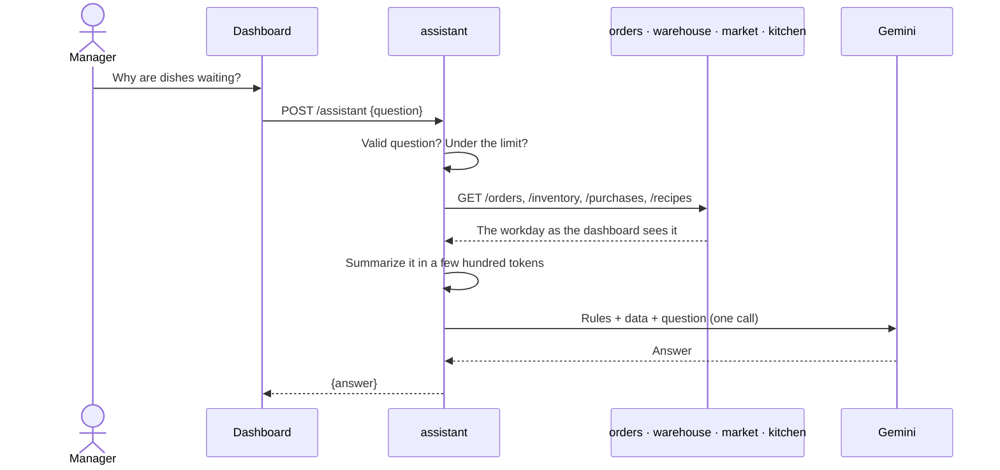

# Operations assistant (AI)

> **Versión en español:** [AI.es.md](AI.es.md).

The manager running the free lunch day is not technical, and during the event has no time to
read tables. The assistant lets them ask in plain words and get a short answer from the live
data of the workday:

- "Why are dishes waiting?"
- "What did we buy the most at the farmers market?"
- "How many ajiacos did we deliver?"

It lives in the right panel of the dashboard, next to the operation it explains.

## How it answers a question



1. **It checks the question.** It must have 1 to 500 characters. An invalid question is refused
   before anything else, and does not count against the limit.
2. **It checks the limit.** A question over the limit is refused without reading data or calling
   Gemini, so it costs nothing.
3. **It reads the workday** from the query API of each service that owns the data, the same
   APIs the dashboard uses. The assistant never reads another service's table.
4. **It summarizes the data** (`summarize.ts`): orders by status, dishes delivered by recipe, the
   20 oldest waiting dishes with what they miss and for how long, each batch (one click of the
   button) numbered like the order history with its time and duration, the slowest and quickest
   batch, the stock with what is on its way, purchases by ingredient and the recipes. Counts instead of every order, so a question
   costs the same small call whether 10 or 10,000 dishes were ordered.
5. **It asks Gemini once** with the rules, the summary and the question.

## Why one call, and not function calling

The first plan was function calling: Gemini would ask for the data tool by tool
(`getInventory`, `getPurchaseHistory`…), and the assistant would run each one.

| | One call with the data (chosen) | Function calling |
| --- | --- | --- |
| Calls to Gemini per question | 1 | 2 to 4 |
| Speed | ~1-4 s | several round trips |
| Free quota | lasts 2-4 times longer | spent 2-4 times faster |
| Data that fits | a workday, summarized | any amount |

Google does not publish fixed numbers for the free quota of Gemini, so every call matters. A
workday, summarized, fits easily in one call. Function calling would pay off with data too large
to send at once, which is not the case here.

## The rules the model follows

The rules travel as Gemini's **system instruction**, apart from the question
(`build-prompt.ts`). Whatever the manager types arrives as the question, so it cannot rewrite
them. The model must:

- answer **only from the data** that comes with the question, and say so when the data does
  not answer it;
- **never invent** numbers, dishes or ingredients;
- answer in the **language of the question**, in at most four short sentences or a short list.
  The dish names are Spanish, so the rules say it plainly: a question in English gets an answer
  in English;
- refuse to change anything: it can place no orders, and says the dashboard does that.

The rules also explain how the day works (the statuses of a dish, why dishes wait, why the market
retries), so the model can explain the data and not only repeat it. The temperature is low
(0.2), so the answers stick to the data.

## Guardrails

| Risk | Guardrail |
| --- | --- |
| The free quota of Gemini runs out | At most 10 questions per minute and 200 per day, counted in DynamoDB so every Lambda sees the same count. Both limits can be configured |
| Gemini is slow, fails or its quota is used up | A 15 s limit per call; the manager gets a clear message ("The assistant cannot answer right now… Try again in a minute") instead of an error |
| Someone tries to change the rules from the question | The rules are the system instruction, apart from the question |
| The AI changes the operation | It has no way to: it only reads the query APIs |
| The API key leaks | In AWS it is a SecureString in SSM Parameter Store, read once per Lambda; locally it is in `.env`, which Git ignores. It is never in the repository |
| There is no key (a reviewer without one) | Everything else works; the assistant answers that it is not configured |

## Model

`gemini-3.5-flash-lite`: the fastest and lightest model available on the free tier when it was
chosen (about 1 s for a short answer). It is pinned instead of a `-latest` alias, so the answers
do not change behavior when Google moves the alias. It can be changed with `GEMINI_MODEL`.

## Setting it up

**Locally:** create a free key, without billing, at https://aistudio.google.com/apikey, copy
[`.env.example`](../.env.example) to `.env` and fill in `GEMINI_API_KEY`. Then
`docker compose up --build`.

**In AWS:** store the key in SSM Parameter Store before deploying:

```bash
aws ssm put-parameter --region us-east-2 --type SecureString \
  --name /alegra-lunch/dev/gemini-api-key --value "<your key>"
```

## Tests

- **Unit:** the summary, the rules and the use case, with fake data, a fake model and a fake
  limiter.
- **Integration:** the Gemini adapter against a local fake of its API, so the tests spend no
  quota and can script any failure (quota used up, errors, slow answers); the data adapter
  against fake services; the limiter against DynamoDB on LocalStack, including 20 questions at
  once with a limit of 5.
- **By hand:** asked "¿Qué ingrediente compramos más y cuántos platos se han entregado?", it
  answered in Spanish "la papa, con 153 unidades en 14 compras… 100 platos", and the data said
  exactly that: potato, 153 units in 14 purchases, 100 dishes delivered.
- **By hand, again:** asked "cuanto tardo la orden que tardo más en completar?", it answered "batch
  1 (100 dishes)… 173 seconds, placed at 19:32:54", the same batch, time and duration as the
  order history.

## Limits, honestly

- It answers about the **current workday** only; comparing workdays would need a list of past
  workdays that orders does not offer yet.
- On the free tier, Google may use what is sent to improve its products. Only operational data
  travels (dishes, ingredients, purchases), nothing personal.
- An answer is as good as the model: the rules and the low temperature keep it to the data, but
  it is a summary for a manager, not an audit.
