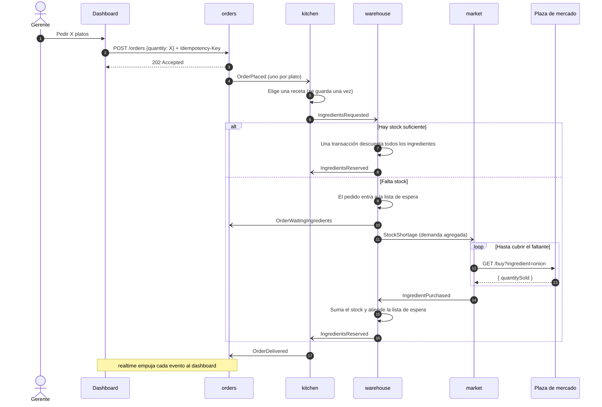
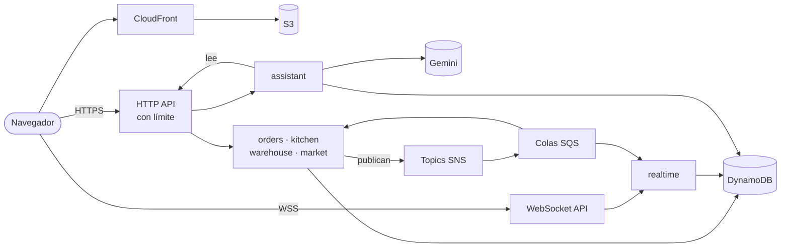

# Arquitectura

> **English version:** [ARCHITECTURE.md](ARCHITECTURE.md).

Cómo está construido Jornada de Almuerzo Gratis y por qué sigue siendo correcto cuando se piden
miles de platos a la vez. Los motivos de cada decisión, y las alternativas descartadas, están
en [PLANNING.es.md](PLANNING.es.md); cómo evolucionó el diseño, con lo que encontró cada prueba,
está en [DEVLOG.es.md](DEVLOG.es.md).

## Servicios

Un *bounded context* por servicio, y una tabla por servicio: ningún servicio lee ni escribe la
tabla de otro. Cuando necesita esos datos, los obtiene por eventos o por la API del dueño.

| Servicio      | Responsabilidad                                                     | Datos (DynamoDB, una tabla por servicio)                      |
| ------------- | ------------------------------------------------------------------- | ------------------------------------------------------------- |
| **orders**    | API del gerente: lotes de platos, jornadas, historial de pedidos    | lotes, pedidos en 10 particiones por jornada, jornadas        |
| **kitchen**   | Receta al azar por plato, pide los ingredientes, entrega            | la receta asignada a cada pedido (el menú vive en el código)  |
| **warehouse** | Reservas atómicas, lista de espera, demanda por ingrediente         | inventario, reservas, pedidos en espera, demanda, faltantes   |
| **market**    | Compra en la plaza de mercado con reintentos                        | compras y el progreso de cada faltante                        |
| **realtime**  | Empuja los eventos a los dashboards                                 | conexiones abiertas                                           |
| **assistant** | Responde en palabras sencillas las preguntas del gerente (IA)       | cuántas preguntas se hicieron en este minuto y en este día    |
| **web**       | Dashboard en React                                                  | ninguno (archivos estáticos)                                  |

Cada servicio sigue una estructura hexagonal:

```
services/<servicio>/src/
├── domain/          reglas puras, sin I/O
├── application/     casos de uso y los puertos que necesitan
├── infrastructure/  adaptadores: DynamoDB, SNS, SQS, la plaza de mercado, Gemini
└── entrypoints/
    ├── wiring.ts    conecta los adaptadores reales con los casos de uso, para los dos entornos
    ├── container/   servidor node:http + poller de SQS (docker compose)
    └── lambda/      handlers de Lambda (AWS)
```

El dominio y los casos de uso no saben dónde corren. El contenedor y la Lambda solo se
diferencian en cómo una petición o un mensaje llega a la misma función `handle`.

## Eventos

Los servicios se comunican con eventos: los topics de SNS reparten cada evento a una cola SQS
por servicio consumidor, y cada suscripción filtra por el atributo `type`, así que cada cola solo
recibe lo que su servicio consume.

| Topic            | Tipo                            | Lleva                          | Lo consumen                          |
| ---------------- | ------------------------------- | ------------------------------ | ------------------------------------ |
| `events`         | estándar                        | todos los eventos menos los faltantes | kitchen, warehouse, orders, realtime |
| `shortages.fifo` | FIFO, agrupado por ingrediente  | `StockShortage`                | market (cola FIFO), realtime         |

Todos los eventos comparten un mismo sobre (`id`, `type`, `version`, `occurredAt`,
`correlationId`, `payload`), definido y validado con zod en `packages/contracts`. Los
productores validan antes de publicar y los consumidores al recibir. Los esquemas son lectores
tolerantes: conservan los campos que no conocen, así que un productor puede agregar un campo
opcional antes de que todos los consumidores lo conozcan.

### La vida de un plato



Cómo leer el diagrama: una flecha sólida (`->>`) es una llamada que espera su respuesta, como
el dashboard enviando el pedido. Una flecha abierta (`-)`) es un evento: el servicio avisa qué
pasó y sigue, sin esperar a nadie.

Cada plato pasa por estos estados, siempre en este orden:

| Estado                | Significado                                                                  |
| --------------------- | ---------------------------------------------------------------------------- |
| `PLACED`              | el gerente lo pidió                                                          |
| `COOKING_REQUESTED`   | la cocina eligió su receta y pidió los ingredientes                          |
| `WAITING_INGREDIENTS` | faltaba un ingrediente y se está comprando (solo algunos platos pasan por aquí) |
| `PREPARING`           | todos los ingredientes están apartados para el plato                         |
| `DELIVERED`           | el plato se sirvió                                                           |

Una cola no garantiza que los eventos lleguen en orden ni una sola vez, así que orders solo
mueve un plato **hacia adelante**. Si un `PREPARING` atrasado llega después de `DELIVERED`, se
ignora: un plato servido nunca aparece como si siguiera cocinándose.

## Concurrencia

### Reservas: la base de datos es el árbitro

**El problema.** Imagina dos platos pidiendo la última cebolla en el mismo instante, atendidos
por dos Lambdas de warehouse en paralelo. Si cada una primero lee el stock ("1 cebolla,
alcanza") y después la descuenta, las dos leen 1 y las dos se la llevan: dos platos para una
cebolla, y el stock queda en -1. Las Lambdas no comparten memoria, así que ningún código puede
coordinarlas; solo la base de datos ve las dos.

**La solución.** Warehouse no lee y después escribe. Le pide a DynamoDB hacerlo todo en **una
sola transacción** (`TransactWriteItems`), que se aplica completa o no se aplica, con una
condición en cada parte:

| Qué toca                         | Qué hace     | Solo si                                                           |
| -------------------------------- | ------------ | ----------------------------------------------------------------- |
| cada ingrediente de la receta    | `stock -= n` | `stock >= n`                                                      |
| la reserva del plato             | la crea      | todavía no existe, así que un mensaje repetido no cambia nada     |
| el plato en la lista de espera   | lo quita     | sigue ahí, así que solo una Lambda lo saca                        |

Lo que pasa entonces:

- **Hay suficiente de todo:** se descuentan todos los ingredientes a la vez y el plato pasa a
  `PREPARING`.
- **Falta algo:** no se descuenta nada, ni siquiera los ingredientes que sí había. DynamoDB dice
  qué condiciones fallaron, así que warehouse sabe exactamente qué le falta al plato y lo pone
  en la lista de espera.
- **Dos platos quieren la última cebolla:** DynamoDB aplica una transacción después de la otra.
  La primera se lleva la cebolla; para la segunda, `stock >= 1` ya es falso, así que se cancela
  y el plato espera la siguiente compra.

Así, muchas Lambdas de warehouse pueden trabajar al mismo tiempo, y el stock nunca baja de cero.

### Demanda agregada: un faltante por ingrediente

Un pedido en espera suma a un contador de demanda lo que necesita de **cada** ingrediente de su
receta. Por cada ingrediente, warehouse guarda `waitingNeed` (las unidades que necesitan los
pedidos en espera) e `inFlight` (las unidades que ya se le pidieron a market):

```
si inFlight > 0 → nada (ya hay una compra de ese ingrediente en camino)
si no: porComprar = waitingNeed − stock
       si porComprar > 0 → inFlight = porComprar (escritura condicional) y publica StockShortage(porComprar)
```

200 platos esperando cebolla producen dos faltantes, no 200. La plaza decide cuánto vende en
cada llamada, así que con un solo faltante activo las sobras se limitan a la última llamada.

La lista de espera es **FIFO flexible**: primero se intenta el pedido más antiguo, pero si no se
puede atender, no bloquea a los que vienen detrás.

### Compras: la cola espera, no el proceso

La cola de market es FIFO, agrupada por ingrediente: una compra a la vez por ingrediente, e
ingredientes distintos en paralelo. Una compra avanza en rondas de hasta 5 llamadas en paralelo,
según lo que falte (`⌈faltante / 2,5⌉`), durante máximo ~10 s por cada entrega del mensaje. El
progreso se suma de forma atómica (`ADD`) en la misma escritura que registra cada venta, así que
un segundo comprador nunca puede sobrescribirlo.

Cuando la plaza no vende nada, el handler devuelve "reintentar en N segundos" y termina: el
entrypoint oculta el mensaje con `ChangeMessageVisibility`. La espera es exponencial con *full
jitter*, con tope de 10 s, y los reintentos no terminan nunca: un plato espera, pero nunca se
pierde. Nadie paga por una Lambda dormida.

### Idempotencia

"Idempotente" significa que hacer algo dos veces tiene el mismo efecto que hacerlo una vez.
Todos los consumidores deben serlo, por cómo funciona SQS.

**El problema: un mensaje puede llegar dos veces.** SQS garantiza que cada mensaje llegue *al
menos* una vez, no *exactamente* una. Si una Lambda termina su trabajo pero muere antes de
avisarle a la cola, la cola lo entrega otra vez. A veces dos copias incluso corren al mismo
tiempo en dos Lambdas. Sin cuidado, una compra de 3 cebollas que llega dos veces sumaría 6 al
stock.

**La solución: el trabajo y la marca de "ya hecho" se guardan juntos.** Cada operación tiene una
llave que la identifica, por ejemplo el id de la compra. En la misma escritura que suma las 3
cebollas, warehouse anota "compra `p-123` aplicada", con la condición de que esa anotación no
exista. Cuando llega la copia, la condición falla, así que la copia no cambia nada. Si las dos
copias corren a la vez, la base de datos deja ganar exactamente a una.

| Operación             | Qué la identifica                                   |
| --------------------- | --------------------------------------------------- |
| Crear un lote         | el `Idempotency-Key` que envía el dashboard         |
| Avanzar un pedido     | el pedido y su estado                               |
| Asignar una receta    | el pedido, así que un reintento conserva la receta  |
| Reservar ingredientes | el pedido                                           |
| Sumar una compra      | la compra                                           |
| Publicar un faltante  | el faltante                                         |

**Un caso más: morir entre guardar y avisar.** Después de guardar, un servicio publica un
evento para que el siguiente continúe, por ejemplo `IngredientsReserved` para la cocina.
Guardar y publicar son dos pasos separados, y el proceso puede morir justo en medio: el trabajo
quedó guardado, pero nadie se enteró. Cuando el mensaje se reintenta, la base de datos responde
"ya hecho"; si el servicio se detuviera ahí, la cocina nunca sabría del plato y quedaría
atascado para siempre. Por eso, una copia que encuentra el trabajo ya hecho **vuelve a publicar
el evento**. Eso puede avisar dos veces, lo cual es inofensivo, porque el siguiente servicio
también es idempotente.

Por la misma razón, los eventos más difíciles de reconstruir (faltantes, platos que salen de la
lista de espera, jornadas nuevas) se guardan como **pendientes** en la misma transacción que el
trabajo, y se vuelven a publicar hasta que quedan marcados como publicados.

**Lo que no se puede hacer idempotente: la plaza de mercado.** No controlamos su API: comprar
dos veces es comprar dos veces. Por eso market consulta lo que ya compró antes de cada ronda y
registra cada venta de inmediato. En el peor caso compra un poco de más, nunca de menos, y las
unidades extra quedan en el stock para los siguientes platos.

### Fallas

| Falla                               | Qué pasa                                                                  |
| ----------------------------------- | ------------------------------------------------------------------------- |
| Cualquier error al procesar         | El mensaje vuelve a la cola con *backoff* exponencial (tope de 10 s)      |
| Un mensaje que rompe el contrato    | Va a la cola de mensajes inválidos (DLQ) y no se reintenta                |
| La plaza no tiene nada que vender   | La compra se reintenta hasta conseguir las unidades                       |
| Un servicio está caído              | Sus mensajes esperan en su cola                                           |
| Un dashboard pierde su conexión     | Se reconecta y vuelve a cargar sus datos                                  |

Ninguna cola usa `maxReceiveCount`: un reintento legítimo nunca debe terminar en la DLQ.

## Jornadas

El reto dice que la bodega siempre inicia con 5 unidades de cada ingrediente, y que el estado
debe sobrevivir reinicios. Una **jornada** concilia las dos cosas: "New workday"
(`POST /workdays`) devuelve la bodega a 5, solo cuando no hay pedidos en curso, y cada pedido y
cada compra pertenecen a una jornada. El historial nunca se borra. La primera jornada se crea
sola.

`WorkdayStarted` puede llegar a warehouse después de un pedido de la jornada nueva, porque SQS
no garantiza el orden. Por eso warehouse solo atiende pedidos de una jornada que ya inició: uno
que llegue antes falla y se reintenta, y una compra atrasada de una jornada anterior nunca entra
al stock nuevo.

## El asistente

El asistente responde preguntas sobre la jornada con Gemini. Su diseño completo, sus reglas y
sus salvaguardas están en [AI.es.md](AI.es.md); aquí va cómo encaja en el sistema.

- **Lee, no escucha.** A diferencia de los demás servicios, no consume eventos ni guarda copia
  de los datos. Cuando llega una pregunta, lee el estado actual de las APIs de consulta de
  orders, warehouse, market y kitchen, las mismas que usa el dashboard. Una copia armada con
  eventos podría ir atrasada; leer en el momento siempre responde con lo que muestra el
  dashboard.
- **Una llamada al modelo por pregunta.** Resume la jornada en unos cientos de tokens y la envía
  con la pregunta: conteos en vez de cada pedido, así la llamada sigue siendo pequeña se pidan 10
  o 10.000 platos.
- **Su única tabla cuenta preguntas.** Un límite por minuto y por día protege la cuota gratuita
  de Gemini. Como las reservas, el conteo vive en DynamoDB, así todas las Lambdas ven el mismo
  número.
- **No puede romper la operación.** Solo hace peticiones GET, y si Gemini falla, solo el panel
  del asistente muestra un aviso: pedir y cocinar siguen igual.

## Dos entornos

|                    | docker compose                             | AWS                                      |
| ------------------ | ------------------------------------------ | ---------------------------------------- |
| HTTP               | `node:http` con un router pequeño          | API Gateway HTTP API → Lambda            |
| Colas              | un poller de SQS en cada contenedor        | event source mappings de Lambda          |
| Envío al dashboard | WebSocket con `ws`, agrupado cada ~500 ms  | API Gateway WebSocket API                |
| Servicios de AWS   | LocalStack 4.14.0                          | DynamoDB, SNS, SQS                       |
| Dashboard          | contenedor nginx                           | S3 + CloudFront                          |
| API key de Gemini  | archivo `.env`, ignorado por Git            | SSM Parameter Store (SecureString)       |



Límites que mantienen gratis el despliegue en AWS:

- Cada Lambda puede correr como máximo 10 copias a la vez, y cada cola dispara como máximo 10.
  La cola de warehouse tiene 20, porque por ella pasan todos los platos y todas las compras.
- El HTTP API rechaza las peticiones por encima de 50 por segundo (picos de 100).
- Los logs se guardan 7 días, y no hay VPC ni NAT Gateway, que se cobrarían por hora.

Además, la cuenta está en el plan gratuito de AWS, que no puede cobrar dinero: un abuso a lo sumo
gastaría créditos, y estos límites mantienen ese gasto pequeño.

## Lo que encontraron las pruebas

Las pruebas de usuario contra la plaza real encontraron problemas que las pruebas unitarias no
podían, entre ellos una sobrecompra de 158 cebollas para 48 necesarias, un campo descartado por
un servicio con un contrato viejo, y eventos que llegaban al dashboard de AWS 20 s tarde. Cada
hallazgo, su causa y su corrección están en el [DEVLOG](DEVLOG.es.md).
