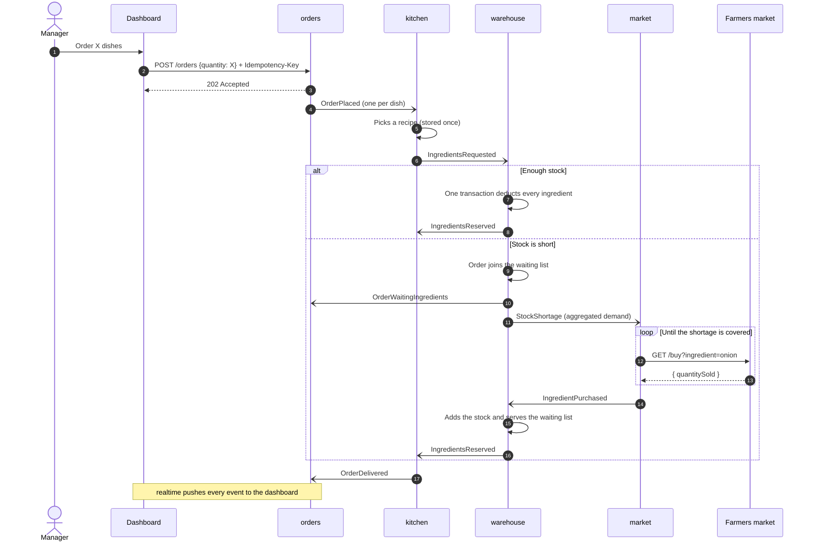
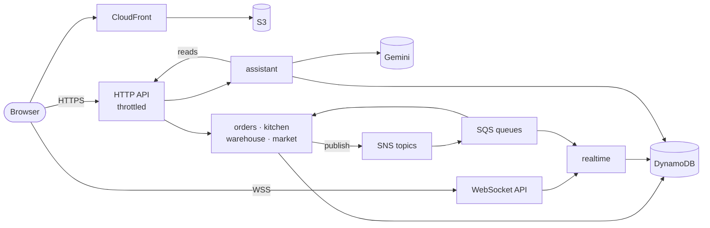

# Architecture

How Free Lunch Day is built and why it stays correct when thousands of dishes are ordered at
once. The reasons behind each decision, and the alternatives that were discarded, are in
[PLANNING.md](PLANNING.md), and how the design evolved, with what each test found, is in
[DEVLOG.md](DEVLOG.md).

## Services

One bounded context per service, and one table per service: no service reads or writes the
table of another. When it needs that data, it gets it from events or from the owner's API.

| Service       | Responsibility                                                 | Data (DynamoDB, single-table)                                |
| ------------- | -------------------------------------------------------------- | ------------------------------------------------------------ |
| **orders**    | Manager API: batches of dishes, workdays, order history        | batches, orders in 10 partitions per workday, workdays       |
| **kitchen**   | Random recipe per dish, asks for ingredients, delivers         | the recipe assigned to each order (the menu lives in code)   |
| **warehouse** | Atomic reservations, waiting list, demand per ingredient       | inventory, reservations, waiting orders, demand, shortages   |
| **market**    | Buys at the farmers market with retries                        | purchases and the progress of each shortage                  |
| **realtime**  | Pushes events to the dashboards                                | open connections                                             |
| **assistant** | Answers the manager's questions in plain words (AI)            | how many questions were asked this minute and this day       |
| **web**       | React dashboard                                                | none (static files)                                          |

Each service follows a hexagonal layout:

```
services/<service>/src/
├── domain/          pure rules, no I/O
├── application/     use cases and the ports they need
├── infrastructure/  adapters: DynamoDB, SNS, SQS, the farmers market, Gemini
└── entrypoints/
    ├── wiring.ts    connects the real adapters to the use cases, for both runtimes
    ├── container/   node:http server + SQS poller (docker compose)
    └── lambda/      Lambda handlers (AWS)
```

The domain and the use cases do not know where they run. The container and the Lambda only
differ in how a request or a message reaches the same `handle` function.

## Events

Services talk through events: SNS topics fan out to one SQS queue per consuming service, and
each subscription filters by the `type` attribute, so a queue only receives what its service
consumes.

| Topic            | Type                                 | Carries                   | Consumed by                             |
| ---------------- | ------------------------------------ | ------------------------- | --------------------------------------- |
| `events`         | standard                             | every event but shortages | kitchen, warehouse, orders, realtime    |
| `shortages.fifo` | FIFO, grouped by ingredient          | `StockShortage`           | market (FIFO queue), realtime           |

Every event shares one envelope (`id`, `type`, `version`, `occurredAt`, `correlationId`,
`payload`), defined and validated with zod in `packages/contracts`. Producers validate before
publishing and consumers validate on arrival. The schemas are tolerant readers: they keep the
fields they do not know, so a producer can add an optional field before every consumer knows it.

### The life of a dish



How to read the diagram: a solid arrow (`->>`) is a call that waits for its answer, like the
dashboard sending the order. An open arrow (`-)`) is an event: the service announces what
happened and moves on, without waiting for anyone.

Each dish goes through these statuses, always in this order:

| Status                | Meaning                                                                    |
| --------------------- | -------------------------------------------------------------------------- |
| `PLACED`              | the manager ordered it                                                     |
| `COOKING_REQUESTED`   | the kitchen picked its recipe and asked for the ingredients                |
| `WAITING_INGREDIENTS` | an ingredient was short and is being bought (only some dishes go through this) |
| `PREPARING`           | every ingredient is set aside for the dish                                 |
| `DELIVERED`           | the dish was served                                                        |

A queue does not promise that events arrive in order or only once, so orders only moves a
dish **forward**. If a late `PREPARING` arrives after `DELIVERED`, it is ignored: a dish that
was served never looks as if it were still cooking.

## Concurrency

### Reservations: the database is the arbiter

**The problem.** Picture two dishes asking for the last onion at the same moment, handled by
two warehouse Lambdas in parallel. If each one first reads the stock ("1 onion, enough") and
then deducts it, both read 1 and both take it: two dishes for one onion, and the stock ends at
-1. The Lambdas share no memory, so no code can coordinate them; only the database sees both.

**The solution.** The warehouse does not read and then write. It asks DynamoDB to do it all in
**one transaction** (`TransactWriteItems`), which applies completely or not at all, with a
condition on each part:

| What it touches               | What it does | Only if                                                  |
| ----------------------------- | ------------ | -------------------------------------------------------- |
| each ingredient of the recipe | `stock -= n` | `stock >= n`                                             |
| the reservation of the dish   | creates it   | it does not exist yet, so a repeated message changes nothing |
| the dish on the waiting list  | removes it   | it is still there, so only one Lambda takes it out       |

What happens then:

- **There is enough of everything:** every ingredient is deducted at once and the dish moves
  to `PREPARING`.
- **Something is short:** nothing is deducted, not even the ingredients that were there.
  DynamoDB says which conditions failed, so the warehouse knows exactly what the dish misses
  and puts it on the waiting list.
- **Two dishes want the last onion:** DynamoDB applies one transaction after the other. The
  first one takes the onion; for the second, `stock >= 1` is now false, so it is cancelled and
  the dish waits for the next purchase.

So many warehouse Lambdas can work at the same time, and the stock never goes below zero.

### Aggregated demand: one shortage per ingredient

A waiting order adds what it needs of **every** ingredient of its recipe to a demand counter.
For each ingredient the warehouse keeps `waitingNeed` (units the waiting orders need) and
`inFlight` (units already asked to the market):

```
if inFlight > 0 → nothing (a purchase of that ingredient is already on its way)
else toBuy = waitingNeed − stock
     if toBuy > 0 → inFlight = toBuy (conditional write) and publish StockShortage(toBuy)
```

200 dishes waiting for onions produce two shortages, not 200. The market decides how much it
sells per call, so with one active shortage the leftovers are bounded by the last call.

The waiting list is **flexible FIFO**: the oldest order is tried first, but when it cannot be
served it does not block the ones behind it.

### Purchases: the queue waits, not the process

The market queue is FIFO, grouped by ingredient: one purchase at a time per ingredient, and
different ingredients in parallel. A purchase runs in rounds of up to 5 parallel calls, sized by
what is missing (`⌈missing / 2.5⌉`), for at most ~10 s per delivery of the message. Progress is
added atomically (`ADD`) in the same write that records each sale, so a second buyer can never
overwrite it.

When the market sells nothing, the handler returns "retry in N seconds" and finishes: the
entrypoint hides the message with `ChangeMessageVisibility`. The delay is exponential with full
jitter, capped at 10 s, and the retries never end, so a dish waits but is never lost. Nobody
pays for a Lambda that sleeps.

### Idempotency

"Idempotent" means that doing something twice has the same effect as doing it once. Every
consumer must be, because of how SQS works.

**The problem: a message can arrive twice.** SQS promises that every message arrives *at
least* once, not *exactly* once. If a Lambda finishes its work but dies before telling the
queue "done", the queue hands the message out again. Sometimes two copies even run at the same
time in two Lambdas. Without care, a purchase of 3 onions arriving twice would add 6 to the
stock.

**The solution: the work and the "already done" mark are saved together.** Each operation
has a key that identifies it, for example the purchase id. In the same database write that adds
the 3 onions, the warehouse records "purchase `p-123` applied", with the condition that this
record does not exist yet. When the copy arrives, the condition fails, so the copy changes
nothing. If both copies run at once, the database lets exactly one of them win.

| Operation            | What identifies it                     |
| -------------------- | -------------------------------------- |
| Place a batch        | the `Idempotency-Key` sent by the dashboard |
| Move an order        | the order and its status               |
| Assign a recipe      | the order, so a retry keeps the same recipe |
| Reserve ingredients  | the order                              |
| Add a purchase       | the purchase                           |
| Publish a shortage   | the shortage                           |

**One more case: dying between saving and announcing.** After saving, a service publishes an
event so that the next service continues, for example `IngredientsReserved` for the kitchen.
Saving and publishing are two separate steps, and the process can die right in between: the
work is saved, but nobody was told. When the message is retried, the database answers "already
done"; if the service then stopped there, the kitchen would never hear about the dish and it
would be stuck forever. So a copy that finds the work already done **publishes the event
again**. That may announce it twice, which is harmless, because the next service is idempotent
too.

For the same reason, the events that are hardest to rebuild (shortages, dishes taken from the
waiting list, new workdays) are saved as **pending** in the same transaction as the work, and
published again until they are marked as published.

**What cannot be made idempotent: the farmers market.** We do not control its API: buying
twice really buys twice. So the market checks what it already bought before each round, and
records each sale right away. In the worst case it buys a little more, never less, and the
extra units go to the stock for the next dishes.

### Failures

| Failure                        | What happens                                                        |
| ------------------------------ | ------------------------------------------------------------------- |
| Any error while handling       | The message returns to the queue with exponential backoff (cap 10 s) |
| A message that breaks the contract | It goes to the dead-letter queue and is not retried             |
| The market has nothing to sell | The purchase retries until it gets the units                        |
| A service is down              | Its messages wait in its queue                                      |
| A dashboard loses its socket   | It reconnects and reloads its data                                  |

No queue uses `maxReceiveCount`: a legitimate retry must never end in the dead-letter queue.

## Workdays

The challenge says the warehouse always starts with 5 units of each ingredient, and that the
state must survive restarts. A **workday** reconciles both: "New workday" (`POST /workdays`)
resets the warehouse to 5, only when no order is in progress, and every order and purchase
belongs to one. History is never deleted. The first workday is created automatically.

`WorkdayStarted` may reach the warehouse after an order of the new workday, since SQS does not
guarantee order. So the warehouse only serves orders of a workday it has already started: an
earlier one fails and is retried, and a late purchase of a previous workday never enters the new
stock.

## The assistant

The assistant answers questions about the workday with Gemini. Its full design, rules and
guardrails are in [AI.md](AI.md); here is how it fits in the system.

- **It reads, it does not listen.** Unlike the other services, it consumes no events and keeps
  no copy of the data. When a question arrives, it reads the current state from the query APIs
  of orders, warehouse, market and kitchen, the same ones the dashboard uses. A copy kept from
  events could lag behind; reading on demand always answers with what the dashboard shows.
- **One call to the model per question.** It summarizes the workday in a few hundred tokens and
  sends it with the question: counts instead of every order, so the call stays small whether 10
  or 10,000 dishes were ordered.
- **Its only table counts questions.** A limit per minute and per day protects the free quota of
  Gemini. Like the reservations, the count lives in DynamoDB, so every Lambda sees the same
  number.
- **It cannot break the operation.** It only makes GET requests, and if Gemini fails, only the
  assistant panel shows a message: ordering and cooking go on.

## Two runtimes

|                 | docker compose                         | AWS                                      |
| --------------- | -------------------------------------- | ---------------------------------------- |
| HTTP            | `node:http` with a small router        | API Gateway HTTP API → Lambda            |
| Queues          | an SQS poller in each container        | Lambda event source mappings             |
| Dashboard push  | WebSocket with `ws`, batched ~500 ms   | API Gateway WebSocket API                |
| AWS services    | LocalStack 4.14.0                      | DynamoDB, SNS, SQS                       |
| Dashboard       | nginx container                        | S3 + CloudFront                          |
| Gemini API key  | `.env` file, ignored by Git             | SSM Parameter Store (SecureString)       |



Limits that keep the AWS deployment free:

- Each Lambda can run at most 10 copies at the same time, and each queue starts at most 10. The
  warehouse queue gets 20, because every dish and every purchase goes through it.
- The HTTP API rejects requests above 50 per second (bursts of 100).
- Logs are kept 7 days, and there is no VPC or NAT gateway, which would be billed by the hour.

On top of that, the account is on the AWS free plan, which cannot charge money: so an abuse
could at most spend credits, and these limits keep that small.

## What testing found

User tests against the real farmers market found problems that unit tests could not, among
them an overbuy of 158 onions for 48 needed, a field dropped by a service on an older contract,
and events reaching the AWS dashboard 20 s late. Each finding, its cause and its fix are in the
[DEVLOG](DEVLOG.md).
