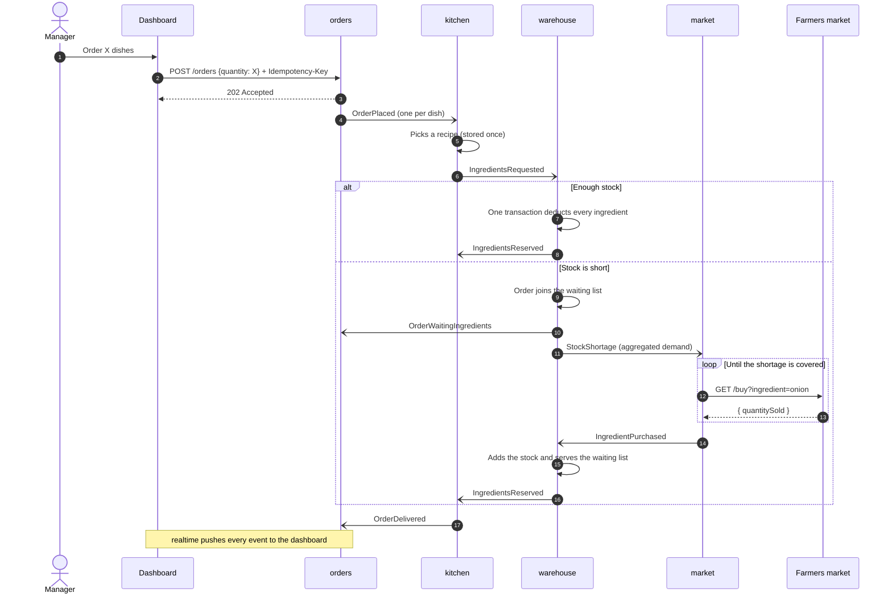
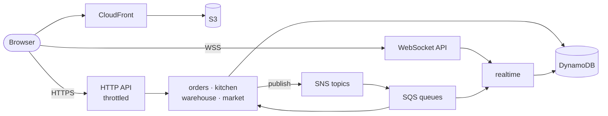

# Architecture

How Free Lunch Day is built and why it stays correct when thousands of dishes are ordered at
once. The reasons behind each decision, and the alternatives that were discarded, are in
[PLANNING.md](PLANNING.md) (§2 and §3).

## Services

One bounded context per service, and one table per service: no service reads or writes the
table of another. When it needs that data, it gets it from events or from the owner's API.

| Service       | Responsibility                                                 | Data (DynamoDB, single-table)                                |
| ------------- | -------------------------------------------------------------- | ------------------------------------------------------------ |
| **orders**    | Manager API: batches of dishes, workdays, order history        | batches, orders in 10 partitions per workday, workdays       |
| **kitchen**   | Random recipe per dish, asks for ingredients, delivers         | the recipe assigned to each order (the menu lives in code)   |
| **warehouse** | Atomic reservations, waiting list, demand per ingredient       | inventory, reservations, waiting orders, demand, shortages   |
| **market**    | Buys at the farmers market with retries                        | purchases and the progress of each shortage                  |
| **realtime**  | Pushes events to the dashboards                                | open connections                                             |
| **web**       | React dashboard                                                | none (static files)                                          |

Each service follows a hexagonal layout:

```
services/<service>/src/
├── domain/          pure rules, no I/O
├── application/     use cases and the ports they need
├── infrastructure/  adapters: DynamoDB, SNS, SQS, the farmers market
└── entrypoints/
    ├── wiring.ts    connects the real adapters to the use cases, for both runtimes
    ├── container/   node:http server + SQS poller (docker compose)
    └── lambda/      Lambda handlers (AWS)
```

The domain and the use cases do not know where they run. The container and the Lambda only
differ in how a request or a message reaches the same `handle` function.

## Events

Services talk through events: SNS topics fan out to one SQS queue per consuming service, and
each subscription filters by the `type` attribute, so a queue only receives what its service
consumes.

| Topic            | Type                                 | Carries                   | Consumed by                             |
| ---------------- | ------------------------------------ | ------------------------- | --------------------------------------- |
| `events`         | standard                             | every event but shortages | kitchen, warehouse, orders, realtime    |
| `shortages.fifo` | FIFO, grouped by ingredient          | `StockShortage`           | market (FIFO queue), realtime           |

Every event shares one envelope (`id`, `type`, `version`, `occurredAt`, `correlationId`,
`payload`), defined and validated with zod in `packages/contracts`. Producers validate before
publishing and consumers validate on arrival. The schemas are tolerant readers: they keep the
fields they do not know, so a producer can add an optional field before every consumer knows it.

### The life of a dish



`->>` is a synchronous call, `-)` an event. An order moves only forward through
`PLACED → COOKING_REQUESTED → WAITING_INGREDIENTS → PREPARING → DELIVERED`, so an event that
arrives late or twice never moves it back.

## Concurrency

### Reservations: the database is the arbiter

Reading the stock, deciding and writing would let two dishes take the same unit. Instead, the
warehouse checks and deducts in one `TransactWriteItems`:

| Item                          | Operation       | Condition                                  |
| ----------------------------- | --------------- | ------------------------------------------ |
| each ingredient of the recipe | `stock -= n`    | `stock >= n`                               |
| the reservation of the order  | create          | does not exist (a repeated message is safe) |
| the waiting entry, if any     | delete          | exists (only one process takes it out)     |

All or nothing: if any ingredient is short, nothing is deducted, and the cancellation reasons
say exactly which ingredients are missing. Many warehouses can run at once; a loser of a race
gets a `TransactionCanceled` and retries, and the stock never goes below zero.

### Aggregated demand: one shortage per ingredient

A waiting order adds what it needs of **every** ingredient of its recipe to a demand counter.
For each ingredient the warehouse keeps `waitingNeed` (units the waiting orders need) and
`inFlight` (units already asked to the market):

```
if inFlight > 0 → nothing (a purchase of that ingredient is already on its way)
else toBuy = waitingNeed − stock
     if toBuy > 0 → inFlight = toBuy (conditional write) and publish StockShortage(toBuy)
```

200 dishes waiting for onions produce two shortages, not 200. The market decides how much it
sells per call, so with one active shortage the leftovers are bounded by the last call.

The waiting list is **flexible FIFO**: the oldest order is tried first, but when it cannot be
served it does not block the ones behind it.

### Purchases: the queue waits, not the process

The market queue is FIFO, grouped by ingredient: one purchase at a time per ingredient, and
different ingredients in parallel. A purchase runs in rounds of up to 5 parallel calls, sized by
what is missing (`⌈missing / 2.5⌉`), for at most ~10 s per delivery of the message. Progress is
added atomically (`ADD`) in the same write that records each sale, so a second buyer can never
overwrite it.

When the market sells nothing, the handler returns "retry in N seconds" and finishes: the
entrypoint hides the message with `ChangeMessageVisibility`. The delay is exponential with full
jitter, capped at 10 s, and the retries never end, so a dish waits but is never lost. Nobody
pays for a Lambda that sleeps.

### Idempotency

SQS delivers at least once, and two copies may run at the same time in different instances. So
the effect and the "already done" mark are written in the same conditional write, and a
duplicate is treated as a success that **publishes the resulting event again**: the database
write and the SNS publish cannot be atomic, and republishing covers a process that died in
between. Every consumer is idempotent, so a second copy of an event is harmless.

| Operation            | Idempotency key                    |
| -------------------- | ---------------------------------- |
| Place a batch        | `Idempotency-Key` header           |
| Move an order        | order id + status rank             |
| Assign a recipe      | order id (a retry keeps the recipe) |
| Reserve ingredients  | order id                           |
| Add a purchase       | purchase id                        |
| Publish a shortage   | shortage id, saved as pending      |

Records that must be published (shortages, reservations taken from the waiting list, workdays)
are stored as **pending** in the same transaction and republished until they are marked as
published.

The farmers market is not idempotent. The market checks what it already bought before each
round and records each sale at once; in the worst case it buys more, never less, and the extra
units go to the stock.

### Failures

| Failure                        | What happens                                                        |
| ------------------------------ | ------------------------------------------------------------------- |
| Any error while handling       | The message returns to the queue with exponential backoff (cap 10 s) |
| A message that breaks the contract | It goes to the dead-letter queue and is not retried             |
| The market has nothing to sell | The purchase retries until it gets the units                        |
| A service is down              | Its messages wait in its queue                                      |
| A dashboard loses its socket   | It reconnects and reloads its data                                  |

No queue uses `maxReceiveCount`: a legitimate retry must never end in the dead-letter queue.

## Workdays

The challenge says the warehouse always starts with 5 units of each ingredient, and that the
state must survive restarts. A **workday** reconciles both: "New workday" (`POST /workdays`)
resets the warehouse to 5, only when no order is in progress, and every order and purchase
belongs to one. History is never deleted. The first workday is created automatically.

## Two runtimes

|                 | docker compose                         | AWS                                      |
| --------------- | -------------------------------------- | ---------------------------------------- |
| HTTP            | `node:http` with a small router        | API Gateway HTTP API → Lambda            |
| Queues          | an SQS poller in each container        | Lambda event source mappings             |
| Dashboard push  | WebSocket with `ws`, batched ~500 ms   | API Gateway WebSocket API                |
| AWS services    | LocalStack 4.14.0                      | DynamoDB, SNS, SQS                       |
| Dashboard       | nginx container                        | S3 + CloudFront                          |



In AWS, each Lambda reserves at most 10 concurrent executions and each queue triggers at most 10,
the HTTP API throttles at 50 requests per second, logs are kept 7 days, and there is no VPC or
NAT gateway: an abuse cannot turn into a bill.

## What testing found

User tests against the real farmers market found problems that unit tests could not:

- **Overbuying.** A large purchase outlived the visibility timeout of its message, so SQS handed
  it to a second buyer, and each buyer overwrote the progress. 158 onions were bought for 48
  needed. Rounds bounded to ~10 s, atomic progress and one message per FIFO worker brought the
  leftovers to 0-2 units.
- **A dropped field.** realtime, still on an older contract, stripped a new optional field and
  the dashboard merged two batches. That is why the schemas are tolerant readers.
- **Late events in AWS.** With a batching window, the last events of a burst waited ~20 s for the
  next poll of the realtime queue. Without the window they reach the dashboard in ~0.2 s.
