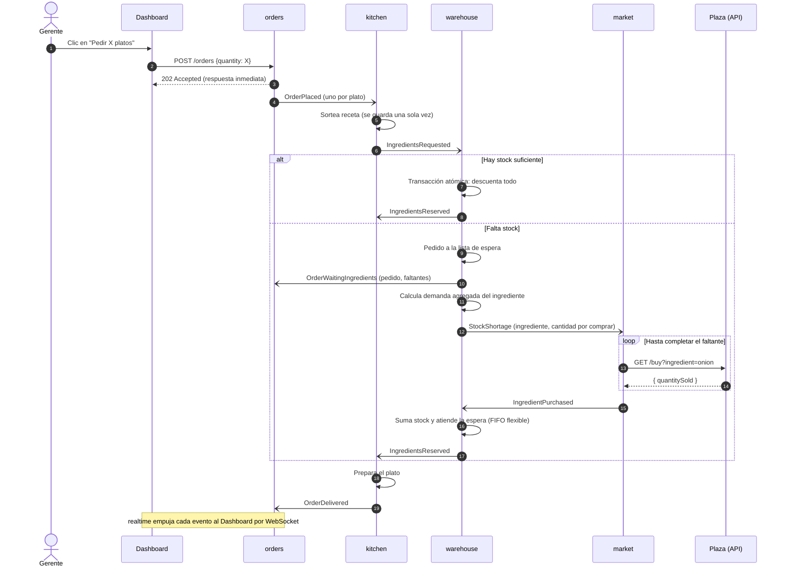

# Jornada de Almuerzo Gratis — Planificación

> Documento escrito **antes de la primera línea de código**. Registra las decisiones,
> el diseño y el plan de trabajo. Cada decisión relevante tendrá además su ADR en `docs/adr/`.

Estado: **v1.8 — Aprobado (17/10/2026)**. Los cambios posteriores se registran como nuevas versiones de este documento o como ADRs.

| Versión | Fecha | Cambio |
|---------|-------|--------|
| 1.0 | 16/10/2026 | Planificación inicial aprobada |
| 1.1 | 16/10/2026 | §3.7: origen y justificación de las jornadas (no forman parte del enunciado). §9: se retira el riesgo del free tier de AWS |
| 1.2 | 16/10/2026 | §3.2 y §3.5: nuevo evento `OrderWaitingIngredients`. `StockShortage` es por ingrediente (demanda agregada), así que no sirve para marcar qué pedido espera ni qué le falta |
| 1.3 | 16/10/2026 | §3.8: justificación de la validación en tiempo de ejecución con zod |
| 1.4 | 16/10/2026 | §3.6: ante un duplicado, el handler **republica** el evento resultante; así no se pierde si el proceso murió entre la escritura y la publicación |
| 1.5 | 17/10/2026 | §3.5: el pedido en espera suma a `waitingNeed` **todos** sus ingredientes, no solo los faltantes; así no queda atascado si el stock que sí había se gasta mientras espera |
| 1.6 | 17/10/2026 | §3.5: **un faltante activo por ingrediente** (no se emite otro mientras `inFlight > 0`), para no comprar de más. §3.5 y §3.6: el faltante se guarda como **pendiente** junto con `inFlight` y se republica hasta publicarse |
| 1.7 | 17/10/2026 | §3.5 y §3.6: la reserva de un pedido que sale de la espera se guarda como **pendiente de publicar** y se republica hasta publicarse; así un plato no queda atascado si el proceso muere antes de avisar a la cocina |
| 1.8 | 17/10/2026 | §3.7: la nueva jornada reinicia los contadores de demanda, y warehouse ignora las compras atrasadas de jornadas anteriores |

---

## 1. Entendimiento del problema

Un restaurante regala almuerzos durante una jornada masiva. Hoy el flujo es manual:

```
Gerente presiona botón → Cocina elige receta al azar → pide ingredientes a la Bodega
→ si faltan, la Bodega compra en la Plaza de mercado → Cocina prepara y entrega
```

**Objetivo:** automatizar el flujo al 100%. Debe soportar miles de comensales y permitir
que el gerente, que no es técnico, vea la operación en tiempo real.

### Reglas de negocio (del enunciado)

| # | Regla |
|---|-------|
| R1 | El gerente pide **X platos** con un botón. |
| R2 | Cada plato recibe una receta **aleatoria** entre 6. |
| R3 | Cada receta usa ingredientes de: tomato, lemon, potato, rice, ketchup, lettuce, onion, cheese, meat, chicken. |
| R4 | La bodega **inicia con 5 unidades** de cada ingrediente. |
| R5 | Si falta stock, se compra en la plaza (`GET https://recruitment.alegra.com/api/farmers-market/buy?ingredient=<name>`). |
| R6 | La plaza responde `{ quantitySold }`. Si es `0` no hay disponibilidad; la compra es exitosa si es un entero > 0. |
| R7 | El plato se entrega **solo cuando están todos sus ingredientes**; al prepararlo, se descuentan del inventario. |

### Requisitos no funcionales

- Microservicios en Node.js + TypeScript, **sin Express/Nest ni frameworks similares**.
- Cada microservicio con su **Dockerfile**, más despliegue **Serverless** (PLUS).
- **Persistencia** que sobreviva reinicios.
- **Escalabilidad y robustez**: muchos pedidos simultáneos sin fallar.
- Despliegue público en **AWS** sin costo.
- **Bonus IA** integrado y funcional en el despliegue.

---

## 2. Decisiones tomadas

| Tema | Decisión | Motivo |
|------|----------|--------|
| Arquitectura | **Híbrida**: hexagonal (puertos y adaptadores); cada servicio corre en Docker (local) y en AWS Lambda (nube) | Cumple los requisitos de Docker y Serverless con el mismo núcleo de dominio |
| Lenguaje | TypeScript (strict) | Seguridad de tipos y mejor soporte para TDD |
| Monorepo | npm workspaces | Viene con Node, sin herramientas extra |
| Testing | Jest (+ ts-jest) con TDD | Red → Green → Refactor en dominio y casos de uso |
| IaC / despliegue | Serverless Framework **v4** | Mencionado explícitamente en el reto; versión con soporte activo |
| Emulación local | LocalStack (SQS, SNS, DynamoDB) | Mismos adaptadores AWS en local y en la nube |
| Tiempo real | WebSockets (API Gateway WebSocket) | El servidor empuja cada cambio al instante |
| Frontend | React + Vite | — |
| IA | Asistente operativo conversacional con **Gemini** (free tier) y function calling | Costo cero; responde con datos reales del sistema |
| Menú | 6 platos bogotanos (ver §4) | — |
| Bus de eventos | **SNS → SQS** (fan-out) con DLQ | Publicar una vez y que cada consumidor tenga su cola; agregar consumidores no modifica al productor (ver §3.2) |
| Compras en la plaza | **Demanda agregada por ingrediente**: la bodega solo pide comprar lo que falta, descontando el stock y lo que ya está en camino | La plaza decide cuánto vende; comprar por pedido generaría compras innecesarias cuando las sobras ya cubrieron a otros pedidos (ver §3.5) |
| Lista de espera | **FIFO flexible** | Prioriza el throughput: si el pedido más antiguo no alcanza, se atiende al siguiente que sí (ver §3.5) |
| Idempotencia | **La base de datos es el árbitro** (escrituras condicionales) | Las Lambdas no comparten memoria; solo la BD ve todos los intentos (ver §3.6) |
| Prueba de carga | Artillery | Escenarios en YAML; corre sobre Node |
| CI | GitHub Actions (lint + test + build) | Valida cada push automáticamente |
| Runtime | Node.js 24 LTS (`nodejs24.x` en Lambda) | La versión más reciente que soporta Lambda; la misma en local, Docker y nube |
| Repositorio | `alegra-lunch` (privado, creado con `gh`) | — |
| Idioma | **Inglés** en código, documentación, commits e interfaz del dashboard | Estándar en equipos. Este documento se traduce como **último paso** del proyecto |
| Calidad | ESLint + Prettier | Estilo consistente y verificado en CI |
| Commits | Conventional Commits; `test:` (rojo) y `feat:` (verde) por separado | El ciclo TDD queda visible en el historial de Git |
| Validación | zod (librería, no framework) | Valida en tiempo de ejecución los eventos, los requests HTTP y las variables de entorno (ver §3.8) |
| Inicio de jornada | **Jornadas separadas**: el botón "Nueva jornada" solo se habilita sin pedidos en curso; reinicia la bodega a 5 unidades de cada ingrediente y el historial se conserva agrupado por jornada (ver §3.7) | La persistencia sobrevive reinicios del servidor; el "inicia con 5" aplica a la jornada, no al proceso. El historial por jornada permite comparar jornadas (útil para el asistente IA) |
| Envío al dashboard | realtime **agrupa** los cambios y envía un paquete cada ~500 ms | Para el ojo humano sigue siendo tiempo real; evita saturar el navegador y la cuota de mensajes de API Gateway |
| Tamaño del pedido | Límite máximo **configurable** (variable de entorno) y validado con zod | Protege el sistema de pedidos absurdos |
| Plaza sin stock (`0`) | Reintentos **indefinidos** con *backoff* exponencial, tope de **10 s**; ningún pedido se pierde | La plaza eventualmente vende; el pedido espera, nunca falla |
| Acceso | Sin login; **rate limiting** en la API y en el asistente | Facilita las pruebas de usuario y protege la operación y la cuota de Gemini |
| Tiempo en espera | El dashboard muestra, por pedido en `WAITING_INGREDIENTS`, el tiempo en espera y los ingredientes faltantes | Con la FIFO flexible, deja visible al gerente cualquier pedido que se demore |
| WebSocket local | Librería `ws` sobre `node:http` | Librería estándar sin dependencias (no es un framework); en AWS se usa API Gateway WebSocket |

**Fechas:** reto recibido el **15/10/2026**; entrega a más tardar el **22/10/2026**.

---

## 3. Arquitectura propuesta

### 3.1 Microservicios (un *bounded context* por servicio, una base de datos por servicio)

| Servicio | Responsabilidad | Persistencia |
|----------|-----------------|--------------|
| **orders** | API del gerente: crea lotes de pedidos, historial y estado de cada pedido (read model) | Tabla `orders` (pedidos y lotes `batches/<key>`) |
| **kitchen** | Elige la receta al azar, solicita ingredientes, prepara y entrega | Tabla `kitchen` (catálogo de recetas y `assignments/<orderId>`) |
| **warehouse** | Inventario y reserva **atómica** de ingredientes; lista de espera FIFO flexible | Tabla `warehouse` (`inventory`, `reservations`, `waiting`, `processed`) |
| **market** | Compra en la plaza con reintentos y *backoff*; historial de compras | Tabla `purchases` |
| **realtime** | Conexiones WebSocket; agrupa los eventos y envía un paquete de cambios al dashboard cada ~500 ms | Tabla `connections` |
| **assistant** | Asistente IA (Gemini + function calling sobre las APIs de consulta) | Tabla `assistant` (contadores de rate limiting) |
| **web** | Dashboard React del gerente | S3 + CloudFront (estático) |

> Cada servicio es **dueño exclusivo** de su tabla: ningún servicio lee ni escribe la tabla de otro.
> Si necesita esos datos, los obtiene por eventos o por la API del dueño.
> La notación `prefijo/<id>` indica tipos de ítem dentro de una misma tabla (*single-table design* por servicio).

### 3.2 Comunicación: asíncrona y orientada a eventos (*coreografía*)

**SNS (topic de eventos) → SQS (una cola por servicio consumidor) con DLQ**.
Así cada servicio escala por separado y ninguno depende de que otro esté arriba: si un consumidor cae, sus mensajes esperan en su cola.
Los errores transitorios se reintentan; la DLQ recibe solo los mensajes inválidos, para revisarlos.

#### Topología: quién produce y quién consume cada evento

> Todos los eventos viajan por el topic SNS y llegan a la cola SQS de cada consumidor.
> Las flechas muestran el flujo lógico. `orders` y `realtime` consumen **todos** los eventos
> para mantener el historial y el dashboard; por eso no se dibujan esas flechas.

```mermaid
flowchart LR
    web["🖥️ Dashboard<br/>(React)"]
    orders["📋 orders"]
    kitchen["👨‍🍳 kitchen"]
    warehouse["📦 warehouse"]
    market["🛒 market"]
    plaza[("🌽 Plaza de mercado<br/>API externa")]
    realtime["📡 realtime"]

    web -- "POST /orders {quantity}" --> orders
    orders -- "OrderPlaced" --> kitchen
    kitchen -- "IngredientsRequested" --> warehouse
    warehouse -- "IngredientsReserved" --> kitchen
    warehouse -- "StockShortage" --> market
    market -- "GET /buy?ingredient=" --> plaza
    market -- "IngredientPurchased" --> warehouse
    kitchen -- "OrderDelivered" --> orders
    realtime -- "WebSocket (push)" --> web
```



#### Secuencia: recorrido de un pedido



> Convención: `->>` es una llamada síncrona (HTTP); `-)` es un evento asíncrono (SNS → SQS).

**Estados de un pedido y el evento que provoca cada uno:**

> Además, `WorkdayStarted` (emitido por orders) reinicia la bodega al comenzar una jornada (ver §3.7).

| Estado | Evento |
|--------|--------|
| `PLACED` | `OrderPlaced` |
| `COOKING_REQUESTED` | `IngredientsRequested` |
| `WAITING_INGREDIENTS` | `OrderWaitingIngredients` (por pedido; `StockShortage` es por ingrediente y solo lo consume market) |
| `PREPARING` | `IngredientsReserved` |
| `DELIVERED` | `OrderDelivered` |

**Contratos de eventos:** tipados y versionados en `packages/contracts` (sobre: `id`, `type`, `version`, `occurredAt`, `correlationId`, `payload`).

### 3.3 Escalabilidad y concurrencia (el punto crítico)

| Riesgo | Mitigación |
|--------|-----------|
| Miles de clics o pedidos de golpe | `POST /orders` responde **202 Accepted** de inmediato y el trabajo se encola. Cantidad máxima por pedido configurable y validada. Rate limiting en API Gateway. El botón se deshabilita mientras hay un envío en curso. |
| Dos pedidos consumen el mismo stock (*race condition*) | Reserva atómica con **DynamoDB TransactWriteItems** y condición `quantity >= requerido` sobre todos los ingredientes de la receta (todo o nada). |
| Avalancha de compras a la plaza por el mismo ingrediente | **Demanda agregada**: la bodega consolida los faltantes de todos los pedidos en espera y solo pide comprar la diferencia (§3.5). Además, la cola **SQS FIFO** de market usa `MessageGroupId = ingredient`: una compra en curso por ingrediente. |
| La plaza responde `0` | Reintentos indefinidos con *backoff* exponencial con jitter y **tope de 10 s**, sin bloquear otros ingredientes. Se implementa extendiendo la visibilidad del mensaje SQS (`ChangeMessageVisibility`), así que el mensaje nunca se pierde. La DLQ queda solo para mensajes inválidos (fallan la validación zod). |
| Entregas duplicadas (SQS es *at-least-once*) | Handlers **idempotentes**; la base de datos es el árbitro mediante escrituras condicionales (ver §3.6). |
| Inanición de pedidos en espera | Lista de espera **FIFO flexible**: se intenta primero el más antiguo; si no alcanza, se sigue con el siguiente. Las compras para el pedido saltado siguen en curso, así que su espera es acotada (ver §3.5). |
| Miles de eventos por segundo hacia el dashboard | realtime agrupa los cambios y envía un paquete cada ~500 ms: el número de mensajes WebSocket depende del tiempo y no del volumen de pedidos. El frontend descarta eventos ya aplicados (`eventId`). |
| Ingrediente "caliente" (`onion` está en los 6 platos) | Se documenta. La compra anticipada queda como mejora futura y como tema para el asistente IA. |

### 3.4 Estructura hexagonal de cada servicio

```
services/<servicio>/
├── src/
│   ├── domain/          # entidades, value objects, reglas puras (100% testeable)
│   ├── application/     # casos de uso + puertos (interfaces)
│   ├── infrastructure/  # adaptadores: DynamoDB, SQS/SNS, HTTP de la plaza, Gemini
│   └── entrypoints/
│       ├── lambda/      # handlers AWS Lambda (nube)
│       └── container/   # servidor node:http + poller SQS (Docker local)
├── tests/{unit,integration}
├── Dockerfile
├── serverless.yml
└── package.json
```

El HTTP local se implementa con el módulo nativo `node:http` (sin Express), con un router mínimo propio en `packages/shared`.

### 3.5 Algoritmo de reserva de ingredientes (warehouse)

**Problema:** con miles de pedidos en paralelo, "leer stock → decidir → escribir" permite
que dos pedidos consuman la misma unidad (*race condition*).

**Solución:** la verificación y el descuento ocurren en **un solo paso atómico** dentro de DynamoDB.

**1. Llega `IngredientsRequested(orderId, receta)`.** Se ejecuta una transacción `TransactWriteItems`:

| Ítem | Operación | Condición |
|------|-----------|-----------|
| `inventory/<ingrediente>` (uno por ingrediente de la receta) | `quantity -= n` | `quantity >= n` |
| `reservations/<orderId>` | crear | `attribute_not_exists` → **idempotencia** (un mensaje SQS repetido no descuenta dos veces; ver §3.6) |
| `waiting/<orderId>` (solo si el pedido venía de la lista de espera) | borrar | `attribute_exists` → dos procesos no pueden sacar el mismo pedido de la espera |

- ✅ **Éxito:** se descuentan **todos** los ingredientes y se emite `IngredientsReserved`. La cocina prepara y entrega.
- ❌ **Falla:** no se descuenta **nada** (todo o nada). Con los `CancellationReasons` se identifican los ingredientes faltantes. Entonces:
  - el pedido entra a la **lista de espera** (ordenada por fecha de llegada; se atiende con FIFO flexible, ver paso 3) y se emite `OrderWaitingIngredients(orderId, faltantes)` para orders y el dashboard;
  - en la misma transacción se suma lo que necesita el pedido al contador de **demanda** de **cada uno de sus ingredientes**, no solo de los faltantes;
  - se evalúa la **demanda agregada** (abajo) y, si hace falta, se emite `StockShortage(shortageId, ingrediente, cantidad)`.

> **Por qué todos los ingredientes y no solo los faltantes:** un Ajiaco espera cebolla, pero sí había papa. Mientras espera, otros pedidos gastan la papa. Cuando llega la cebolla, ahora le falta papa. Si `waitingNeed[potato]` no incluyera al Ajiaco, nadie compraría papa y el pedido quedaría atascado para siempre.
> Contar todos los ingredientes no genera compras de más: para los que hay stock, la fórmula da `≤ 0` y no se compra nada, hasta que ese stock se gaste.

**Demanda agregada por ingrediente.** El ítem `demand/<ingrediente>` lleva dos contadores:

| Contador | Significado |
|----------|-------------|
| `waitingNeed` | Unidades que necesitan, en total, los pedidos en espera |
| `inFlight` | Unidades que ya se le pidió comprar a market y aún no han llegado |

```
si inFlight > 0 → no se emite nada (ya hay una compra en curso de ese ingrediente)
si no: porComprar = waitingNeed − stock
       si porComprar > 0 → inFlight = porComprar (escritura condicional) y se emite StockShortage(porComprar)
```

- La compra es **por ingrediente, no por pedido**, con **un solo faltante activo por ingrediente**. Mientras se compra, los pedidos nuevos solo suman a `waitingNeed`.
- Cuando `inFlight` vuelve a 0 (la compra se completó), se reevalúa y sale **un** faltante por todo lo acumulado.
- La escritura condicional (la BD como árbitro, §3.6) evita que dos evaluaciones simultáneas emitan dos faltantes.
- Las **sobras** (la plaza vende más de lo pedido) entran al stock y se descuentan de la próxima evaluación, así que nunca provocan compras extra.

**Por qué un solo faltante activo:** no podemos decirle a la plaza cuánto vender; ella decide (1 a 4 por llamada en las pruebas).
Si cada pedido emitiera su propio faltante, 3 Changuas seguidas generarían 3 faltantes de 1 cebolla. Market, que no conoce el stock
de la bodega, los compraría los tres aunque el primero ya hubiera traído suficiente: se necesitan 3 y podrían comprarse 9.
Con un faltante activo, las sobras se limitan a la última llamada de cada compra.

> Ejemplo: 200 Changuas esperan 1 cebolla, con stock 0. La primera emite `StockShortage(1)`; las otras 199 solo suman a `waitingNeed`.
> La plaza vende 4 → salen 4 pedidos y `inFlight` vuelve a 0. Se reevalúa: `porComprar = 196` → un solo `StockShortage(196)`.
> En total, **2 faltantes en vez de 200**.

**Faltante pendiente (protección contra caídas):** en la **misma escritura** que fija `inFlight` se guarda `shortages/<shortageId>` como **pendiente**.
Tras publicar el `StockShortage`, se marca como publicado. Cada evaluación del ingrediente republica los pendientes.
Así, si el proceso muere entre la escritura y la publicación, el faltante no se pierde. Sin esto, `inFlight` quedaría contando unidades
que nadie va a comprar y la fórmula no volvería a emitir nada: los pedidos esperarían para siempre. Market es idempotente por `shortageId`, así que republicar es seguro.

**2. El servicio market consume `StockShortage`.** La cola es SQS FIFO con `MessageGroupId = ingrediente`, así que hay una compra en curso por ingrediente y distintos ingredientes se compran en paralelo.
- Llama a la plaza hasta acumular la cantidad pedida. La plaza decide cuánto vende en cada llamada (`quantitySold` puede ser menor o mayor).
- Si recibe `0`, aplica *backoff* exponencial con jitter (1 s, 2 s, 4 s, 8 s, 10 s, 10 s…) y reintenta indefinidamente; el pedido nunca se pierde.
- Registra cada compra en `purchases` (historial) y emite `IngredientPurchased(ingrediente, cantidad)`.

**3. La bodega consume `IngredientPurchased`:**
- Suma el stock con una operación atómica (`ADD`) y resta lo recibido de `inFlight` sin bajar de 0 (si la plaza vendió de más, la diferencia es sobra), en la **misma transacción** que registra `processed/<purchaseId>` con `attribute_not_exists`. `ADD` por sí solo no es idempotente: sin ese registro, un mensaje repetido sumaría la compra dos veces.
- Cada pedido que sale de la espera resta su necesidad de `waitingNeed`. Al terminar el recorrido se reevalúa la demanda agregada.
- Recorre la lista de espera **del más antiguo al más nuevo** y reintenta el paso 1 para cada pedido, con la política **FIFO flexible**:
  - si el pedido más antiguo no alcanza, **no bloquea** a los demás: se salta y se intenta el siguiente;
  - ejemplo: hay 2 papas, el #1 (Ajiaco) necesita 3 y el #2 (Caldo) necesita 2 → sale el #2 ya, y el #1 espera la próxima compra.
- **Reserva pendiente de publicar:** la reserva de cada pedido que sale de la espera se guarda, en la misma transacción, con la marca **no publicada**.
  Tras publicar `IngredientsReserved` se marca como publicada, y cada compra recibida republica las que sigan pendientes.
  Sin esto, si el proceso muere entre reservar y publicar, el reintento de la compra ya no encuentra el pedido en la espera:
  sus ingredientes quedarían descontados y la cocina nunca se enteraría.

**Por qué FIFO flexible y no estricto:**
- El objetivo del evento es entregar el **mayor número de platos en el menor tiempo**.
- Con FIFO estricto, un solo pedido atascado (por ejemplo, porque la plaza devuelve `0` para un ingrediente) detendría toda la cocina (*head-of-line blocking*).

**Cómo se acota la espera del pedido saltado:**
- Su `StockShortage` ya está en la cola de market, que sigue comprando para él.
- Cada vez que llega stock, la lista se recorre desde el más antiguo, así que él siempre tiene la **primera oportunidad**.
- El dashboard muestra el tiempo en espera de cada pedido, para que el gerente vea si alguno se demora.

**Por qué es seguro con concurrencia:**
- Si dos compras llegan a la vez y ambas recorren la lista de espera, las condiciones de la transacción garantizan que cada pedido se reserva **una sola vez** y que el stock **nunca baja de 0**.
- Si un intento pierde la carrera, recibe `TransactionCanceled` y el pedido sigue en espera, sin corrupción de datos.

**Alternativa descartada:** procesar la bodega con un único consumidor (concurrencia 1). Es más simple, pero convierte la bodega en un cuello de botella secuencial y contradice el requisito de escalabilidad.

**Tests TDD que guían esta parte:**
- stock suficiente → reserva y descuento;
- stock insuficiente → no descuenta nada y reporta los faltantes exactos;
- mensaje duplicado → no descuenta dos veces;
- 100 reservas concurrentes sobre stock limitado → stock final ≥ 0 y suma exacta;
- llega una compra → atiende la espera en orden FIFO;
- el pedido más antiguo no alcanza y uno posterior sí → se reserva el posterior y el antiguo sigue en espera (FIFO flexible);
- N pedidos esperando el mismo ingrediente → un solo faltante consolidado por la diferencia;
- con un faltante en curso → los pedidos nuevos no emiten otro faltante del mismo ingrediente;
- el proceso muere entre fijar `inFlight` y publicar → la siguiente evaluación republica el faltante pendiente;
- llega una compra con sobras → no se emiten compras adicionales mientras el stock cubra la espera;
- dos evaluaciones simultáneas de demanda → no duplican `inFlight`.

### 3.6 Idempotencia: la base de datos es el árbitro

**Contexto:** SQS garantiza entrega *at-least-once*, así que un mismo mensaje puede llegar **más de una vez**.
Pasa cuando una Lambda procesa el mensaje pero falla o se agota su tiempo antes de confirmarlo.
Además, dos copias pueden procesarse **al mismo tiempo** en instancias distintas.

**Por qué el árbitro es la BD y no el código:**
- Cada Lambda o contenedor es independiente y sin estado; no comparte memoria con los demás.
- Un `Set` en memoria de "eventos ya vistos" solo protege a su propia instancia y se pierde en cada reinicio.
- El patrón "leer si existe → si no, escribir" tiene la misma *race condition* de §3.5.
- La BD es el único componente que ve **todos** los intentos. Una escritura condicional (`attribute_not_exists`) es atómica: si dos copias llegan a la vez, **exactamente una** gana y la otra recibe `ConditionalCheckFailed`.

**Regla general:** el efecto de negocio y la marca de "ya procesado" se escriben en la **misma transacción**.
Si se escribieran por separado, un fallo entre ambas escrituras dejaría el efecto aplicado sin la marca, o la marca sin el efecto.
Cuando la condición falla por duplicado, el handler lo trata como **éxito** (el trabajo ya estaba hecho): no repite el efecto, **vuelve a publicar el evento resultante** y confirma el mensaje.

**Por qué republicar:** la escritura en la BD y la publicación en SNS no pueden ser atómicas entre sí. Si el proceso guarda el efecto y muere antes de publicar, SQS reintenta el mensaje y la BD responde "ya procesado". Si el handler no publicara nada, el evento se perdería y el pedido quedaría atascado para siempre. Republicar puede emitir el evento dos veces, pero es seguro porque todos los consumidores son idempotentes.

**Alternativa descartada:** *transactional outbox* con DynamoDB Streams (el evento se guarda en la misma transacción y otro proceso lo publica). Es más robusto, pero agrega un stream y una Lambda por servicio y es más difícil de emular en LocalStack.

**Aplicación por servicio:**

| Servicio | Operación | Llave de idempotencia | Escritura condicional |
|----------|-----------|----------------------|----------------------|
| orders | Crear lote (`POST /orders`) | Header `Idempotency-Key` generado por el frontend | `batches/<key>` con `attribute_not_exists`; un doble clic o un reintento HTTP no crea pedidos duplicados |
| orders | Actualizar estado del pedido | `orderId` + estado | Solo avanza: `statusRank < nuevoRank`. Un evento repetido o desordenado no hace retroceder el estado |
| kitchen | Asignar receta aleatoria | `orderId` | `assignments/<orderId>` con `attribute_not_exists`. **Crítico:** si se reprocesa, se reutiliza la receta ya guardada; no se vuelve a sortear otra |
| warehouse | Reservar ingredientes | `orderId` | `reservations/<orderId>` en la misma transacción del descuento (§3.5) |
| warehouse | Sumar compra al stock | `purchaseId` | `processed/<purchaseId>` en la misma transacción del `ADD` |
| warehouse | Sacar un pedido de la espera | `orderId` | Reserva con marca **pendiente de publicar**, en la misma transacción que borra `waiting/<orderId>`; se republica hasta marcarse como publicada (§3.5) |
| warehouse | Emitir faltante | `shortageId` | `shortages/<shortageId>` pendiente, en la misma escritura condicional que fija `inFlight`; se republica hasta marcarse como publicado (§3.5) |
| market | Comprar en la plaza | `shortageId` | Ver limitación abajo |
| realtime | Difundir al dashboard | `eventId` | No escribe estado de negocio; el frontend descarta eventos con `eventId` ya recibido |

**Limitación honesta — la plaza de mercado:** el endpoint externo **no es idempotente** y no podemos
hacer una transacción que abarque nuestra BD y su API. Si la Lambda compra y muere antes de registrar la compra,
el reintento volverá a comprar. Mitigación:
- antes de cada llamada se consulta lo ya comprado para ese `shortageId` (`purchases`) y solo se compra lo que falta;
- cada compra exitosa se registra de inmediato, con escritura condicional por `purchaseId`.

En el peor caso se compra **de más**, nunca de menos. Ese excedente queda en la bodega y lo usan los siguientes pedidos, así que no se pierde.

**Tests TDD:**
- el mismo evento procesado dos veces → un solo efecto;
- dos copias en paralelo → un solo efecto;
- un pedido reprocesado en kitchen → conserva la misma receta;
- un evento de estado desordenado → no retrocede el estado.

### 3.7 Jornadas

> ⚠️ **Este concepto no está en el enunciado del reto.** Es una decisión de diseño propia. Aquí se explica de dónde viene y por qué se incluye.

#### Origen: dos requisitos en tensión

| Requisito | Texto del reto |
|-----------|----------------|
| R4 | "La bodega **inicia siempre** con 5 unidades de cada ingrediente" |
| Persistencia | "El estado del sistema debe **sobrevivir reinicios**" |

Ejemplo: un usuario pide 50 platos y la bodega queda con 2 cebollas y 0 papas. Luego otro usuario abre la misma aplicación:

- **Reiniciar la bodega a 5 cuando arranca el servidor** viola la persistencia: el estado no sobrevive al reinicio.
- **No reiniciarla nunca** viola R4: el "inicia siempre con 5" solo se cumple la primera vez, y ningún usuario posterior puede comprobarlo.

**Interpretación adoptada:** "siempre" se refiere a **cada jornada de donación**, no a cada arranque del proceso.
El reinicio de la bodega pasa a ser una **acción explícita de negocio** ("Nueva jornada") y no un efecto secundario técnico.

#### Mínimo necesario vs. lo que se agrega

| Nivel | Qué incluye | ¿Lo exige el reto? |
|-------|-------------|-------------------|
| Mínimo | Una acción que devuelve la bodega a 5 sin romper la persistencia | Sí, implícitamente (por la tensión R4 ↔ persistencia) |
| **Adoptado** | Jornada como concepto de dominio: `workdayId` en pedidos y compras, historial por jornada, bloqueo si hay pedidos en curso | No: es un valor agregado |

**Por qué se adopta el nivel completo y no el mínimo:**
- **Consistencia:** reiniciar la bodega con pedidos a medio reservar descuadraría el inventario. Por eso solo se permite sin pedidos en curso.
- **Historial útil:** el reto pide mostrar el historial de pedidos y de compras. Agruparlo por jornada evita mezclar eventos distintos sin perder información.
- **Valor para la IA:** el asistente puede comparar jornadas ("¿en qué jornada se compró más cebolla?").
- **Pruebas de usuario:** cada reviewer puede iniciar una jornada limpia y ver el sistema desde el estado inicial descrito en el reto.

**Costo asumido:** un evento más (`WorkdayStarted`), un campo más en los registros y más tests. Se considera razonable frente al beneficio.

**Alternativa descartada:** un botón "Reiniciar bodega" sin concepto de jornada. Es más simple, pero mezcla el historial y no aporta valor de análisis.

#### Definición

Una **jornada** (`workday`) es un evento de donación, de principio a fin. Todo pedido y toda compra pertenecen a una jornada (`workdayId`).

**Flujo de "Nueva jornada":**
1. El gerente presiona **"Nueva jornada"** → `POST /workdays` en **orders**, que es el dueño del concepto de jornada.
2. orders valida que **no haya pedidos en curso** (ningún pedido distinto de `DELIVERED`) en la jornada actual. Si los hay, responde `409 Conflict` y el dashboard explica por qué el botón está deshabilitado.
3. orders cambia la jornada activa con una escritura condicional (la BD como árbitro: dos clics simultáneos no crean dos jornadas) y emite `WorkdayStarted(workdayId)`.
4. **warehouse** consume `WorkdayStarted` y deja **5 unidades** de cada ingrediente. Es idempotente por `workdayId`.
   En la misma escritura reinicia los contadores de demanda (`waitingNeed` e `inFlight` en 0) y descarta los faltantes aún no publicados.
5. **market** y **orders** etiquetan los nuevos registros con el `workdayId` activo.

**Compras atrasadas de una jornada anterior:** puede quedar una compra en curso al cerrar una jornada (por ejemplo, la plaza respondía `0` y market seguía reintentando).
Cuando esa compra llega, warehouse la **ignora**: compara su `workdayId` con la jornada activa, en la misma escritura condicional.
La compra queda en el historial de market, pero no entra al stock de la nueva jornada. Así se cumple R4 en cada jornada: la bodega empieza con 5 y nada de la jornada anterior lo altera.

**Historial:** no se borra nada. El dashboard muestra la jornada actual y permite consultar las anteriores. El asistente IA puede comparar jornadas.

**Primera ejecución:** si no existe ninguna jornada, el sistema crea automáticamente la primera al arrancar (*seed* idempotente).

**Tests TDD:**
- con pedidos en curso → no permite nueva jornada;
- sin pedidos en curso → crea la jornada y la bodega vuelve a 5;
- dos solicitudes simultáneas → una sola jornada nueva;
- `WorkdayStarted` repetido → no altera el inventario dos veces;
- nueva jornada con una compra en curso → los contadores de demanda vuelven a 0;
- llega una compra de una jornada anterior → no entra al stock.

### 3.8 Validación en tiempo de ejecución (zod)

> El reto **no exige** zod. Es una decisión propia; aquí se explica por qué se usa.

#### El problema: los tipos de TypeScript no existen en ejecución

TypeScript verifica los tipos **al compilar**. Al generar JavaScript, todo `interface` o `type` se borra.
Por eso, un dato que llega de afuera (un mensaje SQS, un body HTTP, la respuesta de la plaza) no se verifica:
el código lo trata como si fuera del tipo declarado, aunque no lo sea.

Ejemplo: llega `IngredientPurchased` con `{ ingredient: "garlic", quantity: -3 }`. TypeScript no lo detiene
y la bodega podría restar unidades de un ingrediente que no existe.

#### Qué hace zod

Con un solo **esquema** se obtienen dos cosas:

1. **Validación en ejecución:** `safeParse(dato)` rechaza lo inválido e indica qué campo falla.
2. **Tipo de TypeScript:** `z.infer<typeof Schema>` deriva el tipo del mismo esquema, así que el tipo y la validación **nunca se desalinean**.

#### Dónde se usa: en cada frontera por donde entran datos que no controlamos

| Frontera | Qué protege |
|----------|-------------|
| Eventos SNS/SQS (`parseEvent` en `packages/contracts`) | Un mensaje mal formado va a la DLQ (§3.3) y no corrompe el estado |
| Requests HTTP (`POST /orders`, `POST /workdays`) | Responde `400` ante `quantity: 0`, negativos o texto |
| Variables de entorno | El servicio falla al arrancar, con un mensaje claro, si falta configuración |
| Respuesta de la plaza | Verifica que `quantitySold` sea realmente un entero ≥ 0 |
| Argumentos de las herramientas de Gemini | El modelo no puede pasar parámetros inventados (§5) |

Los **productores** también validan (`createEvent`): un servicio nunca publica un evento que rompa el contrato.

#### Por qué zod y no otra opción

| Opción | Motivo para descartarla |
|--------|------------------------|
| Validación manual (`if typeof …`) | Más código y más errores, y el tipo se declara aparte (duplicado) |
| JSON Schema + `ajv` | Más verboso y no genera los tipos de TypeScript |

**Cumple la restricción del reto:** zod es una librería de validación, no un framework. No impone estructura ni controla el flujo de la aplicación.

---

## 4. Menú bogotano (6 recetas)

| # | Plato | Ingredientes |
|---|-------|--------------|
| 1 | Ajiaco santafereño | chicken ×2, potato ×3, onion ×1, rice ×1 |
| 2 | Caldo de costilla | meat ×2, potato ×2, onion ×1 |
| 3 | Changua con queso | cheese ×2, onion ×1 |
| 4 | Picada bogotana | meat ×2, potato ×2, onion ×1, lemon ×1 |
| 5 | Arroz con pollo | rice ×2, chicken ×1, tomato ×1, onion ×1 |
| 6 | Mazamorra chiquita | meat ×1, potato ×2, onion ×1 |

> Notas:
> - `ketchup` y `lettuce` no se usan (el reto solo exige "al menos un ingrediente de la lista").
> - `onion` está en los 6 platos y `potato` en 4: serán los ingredientes más comprados en la plaza.

---

## 5. Bonus IA — Asistente operativo

**Problema real:** el gerente no es técnico y durante el evento no tiene tiempo de leer tablas.
Necesita respuestas rápidas en lenguaje natural:

- "¿Cuántos pedidos están esperando ingredientes y por qué?"
- "¿Qué ingrediente compramos más en la plaza?"
- "¿Cuántos ajiacos hemos entregado?"

**Enfoque:** Gemini con *function calling*. El modelo **no inventa datos**: solo puede responder
llamando a herramientas de lectura (`getInventory`, `getOrdersSummary`, `getPurchaseHistory`, `getRecipes`).
Es de **solo lectura**, así que la IA no puede ejecutar acciones operativas.

**Salvaguardas:**
- límite de iteraciones de herramientas por pregunta y timeout;
- rate limiting por cliente;
- API key en SSM Parameter Store, nunca en el repositorio;
- mensaje amable cuando se alcanza la cuota del free tier.

Se documentará en detalle en `docs/AI.md`.

---

## 6. Estrategia de pruebas (TDD)

1. **Dominio (unit):** primero el test que falla. Cubre selección aleatoria con semilla inyectable, reserva todo-o-nada, política de compra y reintentos, y máquina de estados del pedido.
2. **Casos de uso (unit):** con adaptadores en memoria (fakes) de los puertos.
3. **Adaptadores (integration):** DynamoDB/SQS contra LocalStack; cliente de la plaza con HTTP simulado.
4. **Contratos:** validación de esquemas de eventos entre productor y consumidor.
5. **End-to-end:** script que pide N platos en docker-compose y verifica que todos lleguen a `DELIVERED`.
6. **Carga:** prueba de miles de pedidos con **Artillery** para demostrar escalabilidad.

Meta de cobertura: ≥ 90% en `domain` y `application`.

---

## 7. Estructura del repositorio

```
alegra-lunch/
├── docs/                 # PLANNING.md, ARCHITECTURE.md, AI.md, adr/
├── packages/
│   ├── contracts/        # eventos y DTOs compartidos (tipos + esquemas)
│   └── shared/           # logger estructurado, router http mínimo, utilidades
├── services/
│   ├── orders/  kitchen/  warehouse/  market/  realtime/  assistant/
├── apps/web/             # React + Vite
├── infra/localstack/     # scripts de bootstrap de colas, topics y tablas
├── docker-compose.yml
├── serverless-compose.yml
└── .github/workflows/    # CI: lint + test + build
```

---

## 8. Plan de trabajo (tareas ordenadas)

| Fecha | Fase | Tareas | Entregable |
|-------|------|--------|-----------|
| 15/10 | **Análisis** | Lectura del reto, decisiones, este documento | `PLANNING.md` |
| 16/10 | **0. Setup** | Instalar Node LTS, Git, Docker Desktop, AWS CLI, Serverless v4; crear repo privado e invitar a `scouting@alegra.com`; monorepo, TS, ESLint/Prettier, Jest | Repo listo con CI en verde |
| 16/10 | **1. Contratos** | Definir eventos y DTOs en `packages/contracts` | Tipos compartidos |
| 17/10 | **2. Dominio (TDD)** | warehouse (reserva), kitchen (receta aleatoria), market (política de compra), orders (estados) | Tests verdes |
| 18/10 | **3. Adaptadores** | DynamoDB, SNS/SQS, cliente de la plaza, `node:http` | Tests de integración en LocalStack |
| 18/10 | **4. Docker local** | Dockerfiles + docker-compose + LocalStack | `docker compose up` con flujo completo |
| 19/10 | **5. Realtime + Web** | WebSocket + dashboard (pedidos, inventario, compras, historial, recetas) | UI funcional local |
| 20/10 | **6. IA** | Servicio assistant + chat en el dashboard | Asistente funcional |
| 20/10 | **7. AWS** | serverless.yml por servicio, despliegue, S3/CloudFront | URL pública |
| 21/10 | **8. Calidad** | Pruebas E2E y de carga, prueba de usuario con un amigo, documentación final | Entregables listos |
| 22/10 | **Traducción** | Traducir este `PLANNING.md` al inglés (último paso del proyecto) | Documentación 100% en inglés |
| 22/10 | **Holgura y entrega** | Imprevistos, revisión final, envío por el formulario | Formulario enviado |

### Checklist de entregables del reto

- [ ] URL de la aplicación desplegada
- [ ] Repositorio privado en GitHub con `scouting@alegra.com` como colaborador
- [ ] `docs/PLANNING.md`
- [ ] Anexos: `docs/ARCHITECTURE.md`, `docs/AI.md`, ADRs

---

## 9. Riesgos

| Riesgo | Plan |
|--------|------|
| Límites del free tier de Gemini | Manejo de errores 429 y mensaje claro en el chat |
| LocalStack no emula algo (p. ej. WebSocket API) | El servicio realtime tendrá en local un adaptador WebSocket con `ws` sobre `node:http` |
| La plaza de mercado se cae o es lenta | Timeouts y reintentos indefinidos con tope de 10 s; los pedidos quedan en espera, no fallan |
